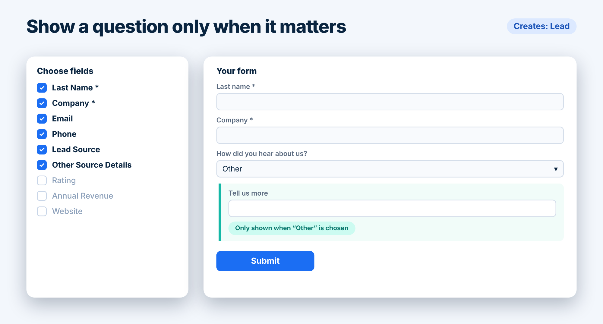

<section class="relative overflow-hidden bg-linear-to-br from-slate-900 via-slate-900 to-slate-800 text-white">
  

  

    <a href="/blog.html" class="inline-flex min-h-11 items-center gap-2 text-sm font-medium text-teal-300 transition hover:text-white focus-visible:outline-2 focus-visible:outline-offset-4 focus-visible:outline-teal-300">
      <svg class="size-4 rotate-180" viewBox="0 0 448 512" fill="currentColor" aria-hidden="true"><use href="#fa-arrow-right"></use></svg>
      Back to the blog
    </a>
    <ul class="mt-6 flex flex-wrap gap-2 text-sm">{{# each page.tags }}<li class="rounded-full bg-white/10 px-3 py-1 text-slate-100 ring-1 ring-white/15">{{ this }}</li>{{/ each }}</ul>
    <h1 class="mt-6 text-3xl font-semibold tracking-tight text-balance sm:text-4xl md:text-5xl">{{ page.title }}</h1>
    
By TwinStack Team &middot; <time datetime="2026-11-11">{{ page.dateFormatted }}</time>

  

</section>

<section class="bg-white">
  

    
You don’t need a developer, a connector or a third-party subscription to put a form on the web and have the answers land in Salesforce. Here is the whole process with Smart Forms &amp; Surveys, from first-time setup to the first submission.

  

</section>

<section class="bg-white">
  

    <ol class="list-none">
      <li class="relative pb-14 pl-16">
        1
        
        <h2 class="pt-1.5 text-2xl font-semibold tracking-tight text-slate-900 sm:text-3xl">Step 1: Set up once</h2>
        
Public forms are served through a Salesforce Site named <strong>PublicForm</strong>. The app’s Get started page checks for it and shows a green card when the site is found and active. If it isn’t, the Setup instructions walk an admin through five short tasks in Salesforce Setup: builder access, the public site, visitor access, a sharing rule and the link address. Click Recheck when you’re done.

        
Until the site is ready, form building is paused. That is deliberate, so nobody builds a form that visitors can’t open.

      </li>
      <li class="relative pb-14 pl-16">
        2
        
        <h2 class="pt-1.5 text-2xl font-semibold tracking-tight text-slate-900 sm:text-3xl">Step 2: Choose what each response creates</h2>
        
Choose <strong>Create a new form</strong>, give it a name and pick the object each response should create. It can be any Salesforce object you can create records in, such as a Lead, a Case or your own custom object. Fields Salesforce needs to save the record are added for you and marked with a red asterisk.

      </li>
      <li class="relative pb-14 pl-16">
        3
        
        <h2 class="pt-1.5 text-2xl font-semibold tracking-tight text-slate-900 sm:text-3xl">Step 3: Pick and arrange the questions</h2>
        
Tick the fields you want and arrange them with the arrows. Text, email, phone, website, numbers, currency, percent, picklists, multi-select picklists, dates, date and time, checkboxes and long text are all supported. You can rename any label to suit your audience.

        
Lookup fields such as Owner stay hidden from visitors until you configure them, because visitors can’t know record Ids. You can apply a <strong>fixed record</strong> automatically (optionally showing its name) or let visitors <strong>choose from up to 25 records</strong> you select. Visitors never see or send a record Id.

      </li>
      <li class="relative pb-14 pl-16">
        4
        
        <h2 class="pt-1.5 text-2xl font-semibold tracking-tight text-slate-900 sm:text-3xl">Step 4: Add the smart parts</h2>
        
Open a question with the pencil icon and switch on <strong>Only show this field for certain answers</strong>. Choose the controlling picklist or checkbox, tap the answers that should reveal the question, then use <strong>Try it</strong> to preview the behaviour before you save. A field depends on one controlling question, and several answers can show it.

        <figure class="mt-8">
          
        </figure>
        
Two more switches are worth knowing about. <strong>File uploads</strong> let visitors attach up to five files to a submission. A <strong>close time</strong> shuts the form automatically at a deadline; you can close or reopen it by hand at any point, and stored submissions are never touched.

      </li>
      <li class="relative pl-16">
        5
        <h2 class="pt-1.5 text-2xl font-semibold tracking-tight text-slate-900 sm:text-3xl">Step 5: Save, share and review</h2>
        
Click <strong>Save &amp; generate form</strong>. That is what publishes your changes, so visitors only see an edit after you save. Each save of an existing form raises its version number by one.

        
Copy the public link, or use <strong>Visitor view</strong> to see exactly what people will see, then paste the link into an email, a chat message or a button on your website.

        
Open <strong>Submissions</strong> to see what arrived. Select any entry to see what the visitor sent and the record it created, and use the <strong>Has error</strong> filter to find anything Salesforce rejected. The error message says what to fix.

      </li>
    </ol>
  

</section>

<section class="bg-white">
  

    

      <h2 class="text-xl font-semibold tracking-tight text-teal-900 sm:text-2xl">A tip for your first form</h2>
      
Start small: three or four fields, one object, no logic. Publish it, submit a test response yourself, and confirm the record looks right. Once that works, add conditional questions and uploads one at a time.

    

  

</section>

<section class="relative overflow-hidden bg-linear-to-br from-slate-900 via-slate-900 to-slate-800 text-white">
  

  

    <h2 class="text-3xl font-semibold tracking-tight text-balance sm:text-4xl">Build your first form today.</h2>
    
Get Smart Forms &amp; Surveys.

    <a href="/contact.html" class="mt-8 inline-flex min-h-12 items-center justify-center gap-2 rounded-xl bg-teal-400 px-6 py-3 text-base font-semibold text-slate-900 shadow-lg shadow-teal-500/20 transition hover:-translate-y-0.5 hover:bg-teal-300 focus-visible:outline-2 focus-visible:outline-offset-4 focus-visible:outline-teal-300">
      Get Smart Forms &amp; Surveys
      <svg class="size-4" viewBox="0 0 448 512" fill="currentColor" aria-hidden="true"><use href="#fa-arrow-right"></use></svg>
    </a>
  

</section>

<section class="bg-white">
  

    <h2 class="text-2xl font-semibold tracking-tight text-slate-900 sm:text-3xl">Related reading</h2>
    <ul class="mt-6 grid gap-4">
      <li>
        <a href="/blog/native-salesforce-forms.html" class="flex min-h-11 items-center justify-between gap-4 rounded-xl border border-slate-200 bg-white p-5 text-base font-medium text-slate-900 shadow-sm transition hover:-translate-y-0.5 hover:border-teal-500 hover:shadow-md focus-visible:outline-2 focus-visible:outline-offset-4 focus-visible:outline-teal-600">
          Why Native Salesforce Forms Beat a Form Tool Plus a Connector
          <svg class="size-4 shrink-0 text-teal-700" viewBox="0 0 448 512" fill="currentColor" aria-hidden="true"><use href="#fa-arrow-right"></use></svg>
        </a>
      </li>
      <li>
        <a href="/blog/secure-public-salesforce-forms.html" class="flex min-h-11 items-center justify-between gap-4 rounded-xl border border-slate-200 bg-white p-5 text-base font-medium text-slate-900 shadow-sm transition hover:-translate-y-0.5 hover:border-teal-500 hover:shadow-md focus-visible:outline-2 focus-visible:outline-offset-4 focus-visible:outline-teal-600">
          Public Salesforce Forms Without the Anxiety: Spam, Uploads and Guest Access
          <svg class="size-4 shrink-0 text-teal-700" viewBox="0 0 448 512" fill="currentColor" aria-hidden="true"><use href="#fa-arrow-right"></use></svg>
        </a>
      </li>
    </ul>
  

</section>
