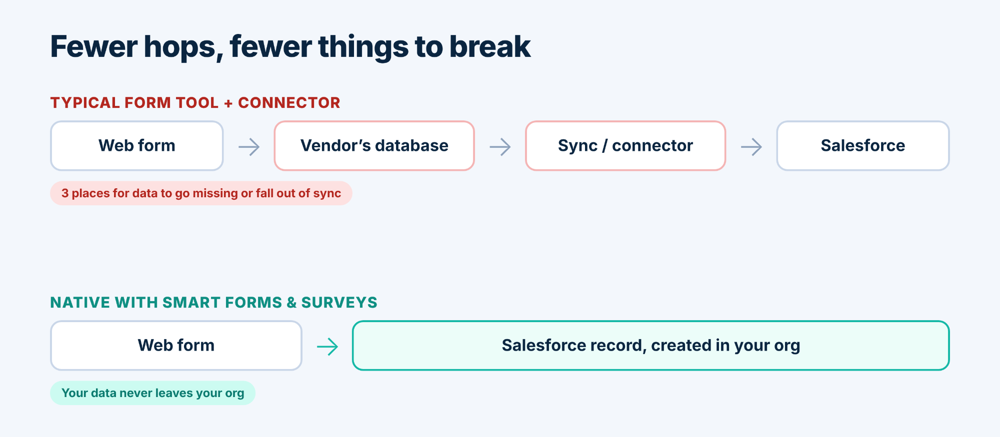

<section class="relative overflow-hidden border-b border-zinc-200 bg-linear-to-b from-zinc-50 to-white">
  

  

    <a href="/blog.html" class="inline-flex min-h-11 items-center gap-2 text-sm font-medium text-zinc-600 transition hover:text-brand focus-visible:outline-2 focus-visible:outline-offset-4 focus-visible:outline-brand">
      <svg class="h-4 w-4" viewBox="0 0 24 24" fill="none" stroke="currentColor" stroke-width="2" stroke-linecap="round" stroke-linejoin="round" aria-hidden="true"><path d="M19 12H5"/><path d="m12 19-7-7 7-7"/></svg>
      Back to the blog
    </a>
    <ul class="mt-6 flex flex-wrap gap-2" aria-label="Tags">
      {{# each page.tags }}<li class="rounded-full border border-zinc-200 bg-white px-3 py-1 text-sm font-medium text-zinc-700">{{ this }}</li>
      {{/ each }}
    </ul>
    <h1 class="mt-6 text-4xl font-semibold tracking-tight text-balance text-zinc-950 sm:text-5xl md:text-[3.25rem] md:leading-[1.1]">Why Native Salesforce Forms Beat a Form Tool Plus a Connector</h1>
    

      TwinStack Team
      
      <time datetime="2026-11-11">{{ page.dateFormatted }}</time>
      
      {{ page.readingTime }}
    

  

</section>

<section class="bg-white">
  

    
Every Salesforce team has a form story. Someone builds a contact form with a popular form tool, wires it to Salesforce through a connector, and for a few months everything is fine. Then a field is renamed, the connector quietly stops, and a week of leads sits in a vendor’s dashboard where nobody is looking.

    <blockquote class="mt-10 rounded-r-2xl border-l-4 border-brand bg-zinc-50 px-6 py-5 text-xl font-semibold leading-snug tracking-tight text-zinc-950 sm:text-2xl">
      The problem is rarely the form. It is the distance between the form and your CRM.
    </blockquote>
  

</section>

<section class="bg-white">
  

    <h2 class="text-3xl font-semibold tracking-tight text-balance text-zinc-950 sm:text-4xl">The hidden cost of “form tool plus connector”</h2>
    

      
Most web form tools store submissions in their own database and then push a copy to Salesforce through an integration. That is three moving parts for what should be one job: the form, the vendor’s storage, and the sync. Each part needs an owner, a login, a line in the budget and a place in your security review. When something breaks, the first hour is spent working out which of the three is at fault.

    

    <ol class="mt-8 grid gap-3 sm:grid-cols-3" aria-label="The three moving parts">
      <li class="rounded-2xl border border-zinc-200 bg-zinc-50 p-5 shadow-sm">
        <svg class="h-6 w-6 text-zinc-500" viewBox="0 0 24 24" fill="none" stroke="currentColor" stroke-width="1.75" stroke-linecap="round" stroke-linejoin="round" aria-hidden="true"><rect x="4" y="3" width="16" height="18" rx="2"/><path d="M8 8h8"/><path d="M8 12h8"/><path d="M8 16h4"/></svg>
        
The form

      </li>
      <li class="rounded-2xl border border-zinc-200 bg-zinc-50 p-5 shadow-sm">
        <svg class="h-6 w-6 text-zinc-500" viewBox="0 0 24 24" fill="none" stroke="currentColor" stroke-width="1.75" stroke-linecap="round" stroke-linejoin="round" aria-hidden="true"><ellipse cx="12" cy="5" rx="8" ry="3"/><path d="M4 5v14c0 1.7 3.6 3 8 3s8-1.3 8-3V5"/><path d="M4 12c0 1.7 3.6 3 8 3s8-1.3 8-3"/></svg>
        
The vendor’s storage

      </li>
      <li class="rounded-2xl border border-zinc-200 bg-zinc-50 p-5 shadow-sm">
        <svg class="h-6 w-6 text-zinc-500" viewBox="0 0 24 24" fill="none" stroke="currentColor" stroke-width="1.75" stroke-linecap="round" stroke-linejoin="round" aria-hidden="true"><path d="M3 12a9 9 0 0 1 15-6.7L21 8"/><path d="M21 3v5h-5"/><path d="M21 12a9 9 0 0 1-15 6.7L3 16"/><path d="M3 21v-5h5"/></svg>
        
The sync

      </li>
    </ol>

    

      
There is also a privacy angle. Your visitors’ answers now live in a second system, outside your org, under a different retention policy and a different set of admins.

    

  

</section>

<section class="border-t border-zinc-200 bg-zinc-50">
  

    <h2 class="text-3xl font-semibold tracking-tight text-balance text-zinc-950 sm:text-4xl">What “native” actually means</h2>
    

      
Smart Forms &amp; Surveys is built on the Salesforce platform. You design the form inside Salesforce, choose what each response should create (a Lead, a Contact, a Case or a custom object) and publish it through a Salesforce Site. When a visitor submits, the app creates that record directly in your org. There is no external database to keep in sync and no second login to manage.

    

    <figure class="mt-10">
      

        
      

    </figure>

    

      
Every submission is also logged in a Submissions view. You can open one to see exactly what the visitor sent, which record it created, and, if Salesforce rejected it, the reason in plain words, such as a required field that was missing. Nobody has to guess why a lead didn’t arrive.

    

  

</section>

<section class="bg-white">
  

    <h2 class="text-3xl font-semibold tracking-tight text-balance text-zinc-950 sm:text-4xl">Four things that get easier</h2>
    

      <article class="rounded-2xl border border-zinc-200 bg-white p-6 shadow-sm transition hover:-translate-y-0.5 hover:border-brand/40 hover:shadow-lg hover:shadow-zinc-900/5 motion-reduce:transition-none motion-reduce:hover:translate-y-0">
        <svg class="h-6 w-6 text-brand" viewBox="0 0 24 24" fill="none" stroke="currentColor" stroke-width="1.75" stroke-linecap="round" stroke-linejoin="round" aria-hidden="true"><circle cx="12" cy="8" r="4"/><path d="M4 21c0-4 3.6-7 8-7s8 3 8 7"/></svg>
        <h3 class="mt-4 text-xl font-semibold tracking-tight text-zinc-950">Ownership</h3>
        
One platform, one set of admins. Builder access is controlled with a permission set, so you decide who can create forms and see submissions.

      </article>
      <article class="rounded-2xl border border-zinc-200 bg-white p-6 shadow-sm transition hover:-translate-y-0.5 hover:border-brand/40 hover:shadow-lg hover:shadow-zinc-900/5 motion-reduce:transition-none motion-reduce:hover:translate-y-0">
        <svg class="h-6 w-6 text-brand" viewBox="0 0 24 24" fill="none" stroke="currentColor" stroke-width="1.75" stroke-linecap="round" stroke-linejoin="round" aria-hidden="true"><path d="M4 20V10"/><path d="M10 20V4"/><path d="M16 20v-7"/><path d="M22 20H2"/></svg>
        <h3 class="mt-4 text-xl font-semibold tracking-tight text-zinc-950">Reporting and automation</h3>
        
Responses are ordinary Salesforce records, so the reports and automation you already run on that object apply as they would for any new record.

      </article>
      <article class="rounded-2xl border border-zinc-200 bg-white p-6 shadow-sm transition hover:-translate-y-0.5 hover:border-brand/40 hover:shadow-lg hover:shadow-zinc-900/5 motion-reduce:transition-none motion-reduce:hover:translate-y-0">
        <svg class="h-6 w-6 text-brand" viewBox="0 0 24 24" fill="none" stroke="currentColor" stroke-width="1.75" stroke-linecap="round" stroke-linejoin="round" aria-hidden="true"><rect x="5" y="11" width="14" height="10" rx="2"/><path d="M8 11V7a4 4 0 0 1 8 0v4"/></svg>
        <h3 class="mt-4 text-xl font-semibold tracking-tight text-zinc-950">Privacy</h3>
        
Visitor data stays in your org instead of being copied to a vendor.

      </article>
      <article class="rounded-2xl border border-zinc-200 bg-white p-6 shadow-sm transition hover:-translate-y-0.5 hover:border-brand/40 hover:shadow-lg hover:shadow-zinc-900/5 motion-reduce:transition-none motion-reduce:hover:translate-y-0">
        <svg class="h-6 w-6 text-brand" viewBox="0 0 24 24" fill="none" stroke="currentColor" stroke-width="1.75" stroke-linecap="round" stroke-linejoin="round" aria-hidden="true"><path d="M14.7 6.3a4 4 0 0 0-5.4 5.4L3 18l3 3 6.3-6.3a4 4 0 0 0 5.4-5.4l-2.5 2.5-2.4-.6-.6-2.4z"/></svg>
        <h3 class="mt-4 text-xl font-semibold tracking-tight text-zinc-950">Troubleshooting</h3>
        
A failed submission shows its own error message, so fixing the form is a two-minute job rather than a support ticket.

      </article>
    

  

</section>

<section class="border-t border-zinc-200 bg-zinc-50">
  

    <h2 class="text-3xl font-semibold tracking-tight text-balance text-zinc-950 sm:text-4xl">When native is the right fit, and when it isn’t</h2>
    

      
Native forms suit teams who already live in Salesforce and want public forms that create records: lead capture, event sign-ups, service requests, applications, surveys stored in a custom object. They are not built for letting a visitor edit an existing record. Public forms only create records, and a submission that carries a record Id is rejected. For anything that touches existing data, that is a feature.

    

    
If your forms mostly feed Salesforce, removing the middle layer is the simplest upgrade you can make.

  

</section>

<section class="relative overflow-hidden bg-zinc-950">
  

  

  

    

      <h2 class="text-3xl font-semibold tracking-tight text-balance text-white sm:text-4xl">Ready to try it?</h2>
      
See Smart Forms &amp; Surveys in action.

    

    <a href="/contact.html" class="group inline-flex min-h-12 items-center justify-center gap-2 rounded-xl bg-white px-6 py-3 text-base font-semibold text-zinc-950 shadow-lg shadow-black/20 ring-1 ring-white/20 transition hover:-translate-y-0.5 hover:bg-zinc-100 focus-visible:outline-2 focus-visible:outline-offset-4 focus-visible:outline-white motion-reduce:transition-none motion-reduce:hover:translate-y-0">
      Get Smart Forms &amp; Surveys
      <svg class="h-4 w-4 transition group-hover:translate-x-0.5 motion-reduce:transition-none" viewBox="0 0 24 24" fill="none" stroke="currentColor" stroke-width="2" stroke-linecap="round" stroke-linejoin="round" aria-hidden="true"><path d="M5 12h14"/><path d="m12 5 7 7-7 7"/></svg>
    </a>
  

</section>

<section class="bg-white">
  

    <h2 class="text-2xl font-semibold tracking-tight text-zinc-950 sm:text-3xl">Related reading</h2>
    <ul class="mt-6 grid gap-4 sm:grid-cols-2">
      <li>
        <a href="/blog/build-public-salesforce-form.html" class="flex h-full min-h-11 items-start justify-between gap-3 rounded-2xl border border-zinc-200 bg-white p-5 font-semibold leading-snug text-zinc-950 shadow-sm transition hover:-translate-y-0.5 hover:border-brand/40 hover:text-brand hover:shadow-lg hover:shadow-zinc-900/5 focus-visible:outline-2 focus-visible:outline-offset-4 focus-visible:outline-brand motion-reduce:transition-none motion-reduce:hover:translate-y-0">
          How to Build a Public Salesforce Form in Five Steps (No Code)
          <svg class="mt-1 h-4 w-4 shrink-0" viewBox="0 0 24 24" fill="none" stroke="currentColor" stroke-width="2" stroke-linecap="round" stroke-linejoin="round" aria-hidden="true"><path d="M5 12h14"/><path d="m12 5 7 7-7 7"/></svg>
        </a>
      </li>
      <li>
        <a href="/blog/secure-public-salesforce-forms.html" class="flex h-full min-h-11 items-start justify-between gap-3 rounded-2xl border border-zinc-200 bg-white p-5 font-semibold leading-snug text-zinc-950 shadow-sm transition hover:-translate-y-0.5 hover:border-brand/40 hover:text-brand hover:shadow-lg hover:shadow-zinc-900/5 focus-visible:outline-2 focus-visible:outline-offset-4 focus-visible:outline-brand motion-reduce:transition-none motion-reduce:hover:translate-y-0">
          Public Salesforce Forms Without the Anxiety: Spam, Uploads and Guest Access
          <svg class="mt-1 h-4 w-4 shrink-0" viewBox="0 0 24 24" fill="none" stroke="currentColor" stroke-width="2" stroke-linecap="round" stroke-linejoin="round" aria-hidden="true"><path d="M5 12h14"/><path d="m12 5 7 7-7 7"/></svg>
        </a>
      </li>
    </ul>
    <a href="/blog.html" class="mt-8 inline-flex min-h-11 items-center gap-2 text-sm font-medium text-zinc-600 transition hover:text-brand focus-visible:outline-2 focus-visible:outline-offset-4 focus-visible:outline-brand">
      <svg class="h-4 w-4" viewBox="0 0 24 24" fill="none" stroke="currentColor" stroke-width="2" stroke-linecap="round" stroke-linejoin="round" aria-hidden="true"><path d="M19 12H5"/><path d="m12 19-7-7 7-7"/></svg>
      Back to the blog
    </a>
  

</section>
