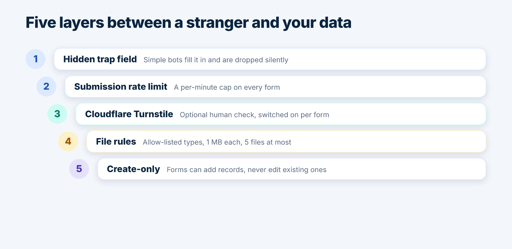

<section class="relative overflow-hidden bg-slate-950">
  

  

  

    <a href="/blog.html" class="inline-flex min-h-11 items-center gap-2 text-sm font-medium text-slate-300 transition hover:text-white focus-visible:outline-2 focus-visible:outline-offset-4 focus-visible:outline-white">
      <svg class="h-4 w-4" viewBox="0 0 24 24" fill="none" stroke="currentColor" stroke-width="2" stroke-linecap="round" stroke-linejoin="round" aria-hidden="true"><path d="M19 12H5"/><path d="m12 19-7-7 7-7"/></svg>
      Back to the blog
    </a>
    <ul class="mt-6 flex flex-wrap gap-2" aria-label="Tags">
      <li class="rounded-full bg-white/10 px-3 py-1 text-sm font-medium text-slate-100 ring-1 ring-white/20">Salesforce security</li>
      <li class="rounded-full bg-white/10 px-3 py-1 text-sm font-medium text-slate-100 ring-1 ring-white/20">spam protection</li>
      <li class="rounded-full bg-white/10 px-3 py-1 text-sm font-medium text-slate-100 ring-1 ring-white/20">Cloudflare Turnstile</li>
      <li class="rounded-full bg-white/10 px-3 py-1 text-sm font-medium text-slate-100 ring-1 ring-white/20">file uploads</li>
      <li class="rounded-full bg-white/10 px-3 py-1 text-sm font-medium text-slate-100 ring-1 ring-white/20">guest user</li>
    </ul>
    <h1 class="mt-6 max-w-3xl text-3xl font-semibold tracking-tight text-balance text-white sm:text-4xl md:text-5xl">Public Salesforce Forms Without the Anxiety: Spam, Uploads and Guest Access</h1>
    

      By TwinStack Team
      &middot;
      <time datetime="2026-11-11">{{ page.dateFormatted }}</time>
    

  

</section>

<section class="bg-white">
  

    

      
A public form is, by definition, open to everyone. That is the point, and it is also why admins feel a little nervous the first time they publish one. Bots will find it. Someone will try to upload something odd. The question is what stands between those things and your data.

    

    
Smart Forms &amp; Surveys answers with layers rather than a single lock. Some are on from the start, and some you switch on per form.

  

</section>

<section class="bg-slate-50">
  

    <figure>
      
    </figure>
  

</section>

<section class="bg-white">
  

    

      

        1
        2
      

      <h2 class="text-2xl font-semibold tracking-tight text-balance text-slate-950 sm:text-3xl">Layers one and two: the trap field and the rate limit</h2>
    

    

      
Every form carries a hidden field that people never see. Simple bots fill in everything they find, and a submission with that field filled in is dropped silently. Every form also has a limit on submissions per minute, so a flood of requests can’t pile up. Neither needs any setup.

    

  

</section>

<section class="border-t border-slate-200 bg-slate-50">
  

    

      3
      <h2 class="text-2xl font-semibold tracking-tight text-balance text-slate-950 sm:text-3xl">Layer three: a human check with Cloudflare Turnstile</h2>
    

    

      
For forms that attract more determined bots, connect your own free Cloudflare account. On the Spam protection tab you add a Turnstile widget for your form domain, copy the site key and the secret key into the app, and test the connection. It takes about five minutes, and the keys remain yours.

      
Then switch on <strong class="font-semibold text-slate-950">Spam check</strong> for each form and save it. Visitors complete a short check, which usually needs no clicking, before they can submit. Remember to save the form again after switching it on, because saving is what publishes the change.

    

    

      
If you ever remove your keys, forms that require the spam check stop accepting submissions until you add new keys or switch the check off. The tab tells you how many forms are affected before you remove anything.

    

  

</section>

<section class="bg-white">
  

    

      4
      <h2 class="text-2xl font-semibold tracking-tight text-balance text-slate-950 sm:text-3xl">Layer four: strict rules for file uploads</h2>
    

    

      
Uploads are off until you enable them on a form, and then they are limited. A visitor can attach up to five files of up to 1 MB each. Only documents and images are accepted, such as JPG, PNG, PDF, Word, Excel, PowerPoint, text and CSV files. Anything a browser could run, including HTML, SVG and JavaScript, is rejected. File names, sizes and types are checked on the server, not just in the visitor’s browser, and uploads are rate-limited too.

    

  

</section>

<section class="border-t border-slate-200 bg-slate-50">
  

    

      5
      <h2 class="text-2xl font-semibold tracking-tight text-balance text-slate-950 sm:text-3xl">Layer five: create-only access</h2>
    

    

      
Public forms can only add records. A submission that includes a record Id is rejected, so nobody can use a form link to overwrite existing data. Lookup fields stay hidden until you configure them, and visitors never see or send record Ids.

      
Visitors also can’t see your other forms, your submissions or your Salesforce data.

    

  

</section>

<section class="bg-white">
  

    <h2 class="text-2xl font-semibold tracking-tight text-balance text-slate-950 sm:text-3xl">Keep the admin side tight, too</h2>
    

      
Building forms and viewing submissions needs the <strong class="font-semibold text-slate-950">FormBuilder_Admin</strong> permission set. It shows every form and submission, so give it only to people who should see that data, and never to the site’s guest user.

    

  

</section>

<section class="border-t border-slate-200 bg-slate-50">
  

    <h2 class="text-2xl font-semibold tracking-tight text-balance text-slate-950 sm:text-3xl">A five-point checklist before you publish</h2>
    <ul class="mt-8 space-y-3" aria-label="Pre-publish checklist">
      <li>
        <label class="flex min-h-11 cursor-pointer items-start gap-4 rounded-2xl bg-white p-4 shadow-sm ring-1 ring-slate-200 transition hover:-translate-y-0.5 hover:shadow-md hover:ring-brand/40 has-[:focus-visible]:ring-2 has-[:focus-visible]:ring-brand sm:p-5">
          <input type="checkbox" class="peer mt-1 h-5 w-5 shrink-0 cursor-pointer rounded border-slate-400 accent-teal-700">
          Confirm the PublicForm site is active and the guest user has only the access the setup guide describes.
        </label>
      </li>
      <li>
        <label class="flex min-h-11 cursor-pointer items-start gap-4 rounded-2xl bg-white p-4 shadow-sm ring-1 ring-slate-200 transition hover:-translate-y-0.5 hover:shadow-md hover:ring-brand/40 has-[:focus-visible]:ring-2 has-[:focus-visible]:ring-brand sm:p-5">
          <input type="checkbox" class="peer mt-1 h-5 w-5 shrink-0 cursor-pointer rounded border-slate-400 accent-teal-700">
          Connect Turnstile and switch on Spam check for forms that will be widely shared.
        </label>
      </li>
      <li>
        <label class="flex min-h-11 cursor-pointer items-start gap-4 rounded-2xl bg-white p-4 shadow-sm ring-1 ring-slate-200 transition hover:-translate-y-0.5 hover:shadow-md hover:ring-brand/40 has-[:focus-visible]:ring-2 has-[:focus-visible]:ring-brand sm:p-5">
          <input type="checkbox" class="peer mt-1 h-5 w-5 shrink-0 cursor-pointer rounded border-slate-400 accent-teal-700">
          Enable uploads only on forms that need them, and set the lowest file count that works.
        </label>
      </li>
      <li>
        <label class="flex min-h-11 cursor-pointer items-start gap-4 rounded-2xl bg-white p-4 shadow-sm ring-1 ring-slate-200 transition hover:-translate-y-0.5 hover:shadow-md hover:ring-brand/40 has-[:focus-visible]:ring-2 has-[:focus-visible]:ring-brand sm:p-5">
          <input type="checkbox" class="peer mt-1 h-5 w-5 shrink-0 cursor-pointer rounded border-slate-400 accent-teal-700">
          Configure lookup fields deliberately, choosing a fixed record or a short list of names.
        </label>
      </li>
      <li>
        <label class="flex min-h-11 cursor-pointer items-start gap-4 rounded-2xl bg-white p-4 shadow-sm ring-1 ring-slate-200 transition hover:-translate-y-0.5 hover:shadow-md hover:ring-brand/40 has-[:focus-visible]:ring-2 has-[:focus-visible]:ring-brand sm:p-5">
          <input type="checkbox" class="peer mt-1 h-5 w-5 shrink-0 cursor-pointer rounded border-slate-400 accent-teal-700">
          Save the form, open the Visitor view, and send yourself a test submission.
        </label>
      </li>
    </ul>
  

</section>

<section class="relative overflow-hidden bg-slate-950">
  

  

  

    <h2 class="text-3xl font-semibold tracking-tight text-balance text-white sm:text-4xl">Publish with confidence.</h2>
    
Explore Smart Forms &amp; Surveys.

    <a href="/contact.html" class="mt-8 inline-flex min-h-12 items-center justify-center gap-2 rounded-xl bg-brand px-6 py-3 text-base font-semibold text-white shadow-lg shadow-brand/30 transition hover:-translate-y-0.5 hover:shadow-xl focus-visible:outline-2 focus-visible:outline-offset-4 focus-visible:outline-white">
      Get Smart Forms &amp; Surveys
      <svg class="h-4 w-4" viewBox="0 0 24 24" fill="none" stroke="currentColor" stroke-width="2" stroke-linecap="round" stroke-linejoin="round" aria-hidden="true"><path d="M5 12h14"/><path d="m12 5 7 7-7 7"/></svg>
    </a>
  

</section>

<section class="bg-white">
  

    <h2 class="text-2xl font-semibold tracking-tight text-balance text-slate-950 sm:text-3xl">Related reading</h2>
    <ul class="mt-6 space-y-3">
      <li>
        <a href="/blog/native-salesforce-forms.html" class="group flex min-h-11 items-center justify-between gap-4 rounded-2xl p-4 text-lg font-medium text-slate-900 ring-1 ring-slate-200 transition hover:-translate-y-0.5 hover:text-brand hover:shadow-md focus-visible:outline-2 focus-visible:outline-offset-2 focus-visible:outline-brand sm:p-5">
          Why Native Salesforce Forms Beat a Form Tool Plus a Connector
          <svg class="h-5 w-5 shrink-0 transition group-hover:translate-x-1" viewBox="0 0 24 24" fill="none" stroke="currentColor" stroke-width="2" stroke-linecap="round" stroke-linejoin="round" aria-hidden="true"><path d="M5 12h14"/><path d="m12 5 7 7-7 7"/></svg>
        </a>
      </li>
      <li>
        <a href="/blog/build-public-salesforce-form.html" class="group flex min-h-11 items-center justify-between gap-4 rounded-2xl p-4 text-lg font-medium text-slate-900 ring-1 ring-slate-200 transition hover:-translate-y-0.5 hover:text-brand hover:shadow-md focus-visible:outline-2 focus-visible:outline-offset-2 focus-visible:outline-brand sm:p-5">
          How to Build a Public Salesforce Form in Five Steps (No Code)
          <svg class="h-5 w-5 shrink-0 transition group-hover:translate-x-1" viewBox="0 0 24 24" fill="none" stroke="currentColor" stroke-width="2" stroke-linecap="round" stroke-linejoin="round" aria-hidden="true"><path d="M5 12h14"/><path d="m12 5 7 7-7 7"/></svg>
        </a>
      </li>
    </ul>
  

</section>
