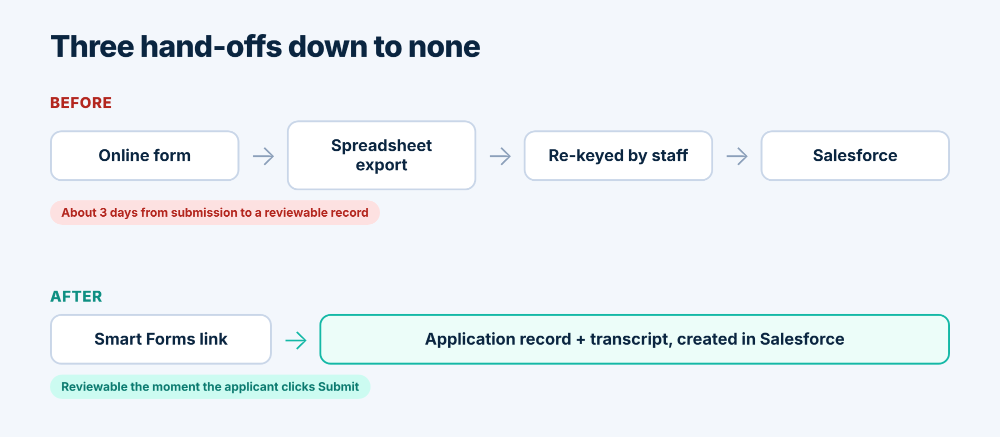
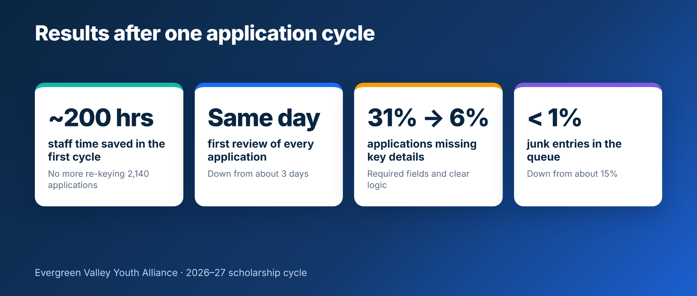

<section class="relative overflow-hidden bg-zinc-950 text-white">
  

  

  

    <a href="/case-studies.html" class="inline-flex min-h-11 items-center gap-2 text-sm font-medium text-teal-300 transition hover:text-white focus-visible:outline-2 focus-visible:outline-offset-4 focus-visible:outline-teal-300">
      <svg class="h-4 w-4" viewBox="0 0 24 24" fill="none" stroke="currentColor" stroke-width="2" stroke-linecap="round" stroke-linejoin="round" aria-hidden="true"><path d="M19 12H5"/><path d="m12 19-7-7 7-7"/></svg>
      Back to case studies
    </a>
    

      Case study · Smart Forms &amp; Surveys
      Illustrative scenario
    

    <h1 class="mt-6 max-w-4xl text-3xl font-semibold tracking-tight text-balance sm:text-5xl md:text-6xl">{{ page.title }}</h1>
    

      <time datetime="2026-11-11">{{ page.dateFormatted }}</time>
      ·
      By TwinStack Team
    

  

</section>

<section class="bg-white">
  

    <h2 class="text-sm font-semibold uppercase tracking-wider text-teal-700">At a glance</h2>
    

      <table class="w-full min-w-[20rem] border-collapse text-left text-base">
        <tbody class="divide-y divide-zinc-200">
          <tr class="align-top">
            <th scope="row" class="w-2/5 bg-zinc-50 px-4 py-4 font-semibold text-zinc-900 sm:w-1/4 sm:px-6">Organisation</th>
            <td class="px-4 py-4 text-zinc-700 sm:px-6">Evergreen Valley Youth Alliance, a regional youth-development nonprofit</td>
          </tr>
          <tr class="align-top">
            <th scope="row" class="bg-zinc-50 px-4 py-4 font-semibold text-zinc-900 sm:px-6">Team</th>
            <td class="px-4 py-4 text-zinc-700 sm:px-6">14 staff and about 60 volunteers</td>
          </tr>
          <tr class="align-top">
            <th scope="row" class="bg-zinc-50 px-4 py-4 font-semibold text-zinc-900 sm:px-6">Use case</th>
            <td class="px-4 py-4 text-zinc-700 sm:px-6">Annual scholarship application intake</td>
          </tr>
          <tr class="align-top">
            <th scope="row" class="bg-zinc-50 px-4 py-4 font-semibold text-zinc-900 sm:px-6">Salesforce object</th>
            <td class="px-4 py-4 text-zinc-700 sm:px-6">Custom object: Scholarship Application</td>
          </tr>
          <tr class="align-top">
            <th scope="row" class="bg-zinc-50 px-4 py-4 font-semibold text-zinc-900 sm:px-6">Features used</th>
            <td class="px-4 py-4 text-zinc-700 sm:px-6">Conditional questions, file uploads, fixed-record lookup, Turnstile spam check, automatic close time</td>
          </tr>
        </tbody>
      </table>
    

    

      <svg class="mt-0.5 h-5 w-5 shrink-0 text-amber-700" viewBox="0 0 24 24" fill="none" stroke="currentColor" stroke-width="2" stroke-linecap="round" stroke-linejoin="round" aria-hidden="true"><circle cx="12" cy="12" r="10"/><path d="M12 16v-4"/><path d="M12 8h.01"/></svg>
      
Evergreen Valley Youth Alliance is a fictional organisation, and the figures shown illustrate typical results.

    

  

</section>

<section class="bg-zinc-50">
  

    <h2 class="text-3xl font-semibold tracking-tight text-balance text-zinc-950 sm:text-4xl">About Evergreen Valley Youth Alliance</h2>
    
Evergreen Valley Youth Alliance runs mentoring, tutoring and scholarship programs for young people across its region. Its small operations team already managed donors, volunteers and program participants in Salesforce, so Salesforce was the natural home for scholarship applications too. It was just that applications weren’t getting there on their own.

  

</section>

<section class="bg-white">
  

    <h2 class="text-3xl font-semibold tracking-tight text-balance text-zinc-950 sm:text-4xl">The challenge</h2>
    

      
Each spring the Alliance received more than two thousand scholarship applications through a general-purpose online form. Responses landed in a spreadsheet, and a staff member then re-keyed each one into Salesforce. Transcripts arrived separately by email and had to be matched by hand.

      
“By the time an application became a record, it was often three days old,” said Maya Okafor, Programs Operations Manager. “And by then we’d already lost track of which ones were missing documents.”

      
The numbers told the same story. About 31% of applications were missing key details, and roughly 15% of entries in the queue were junk submissions from bots. Reviewers spent the first week of every cycle cleaning data instead of reading applications.

    

  

</section>

<section class="relative overflow-hidden bg-zinc-950 text-white">
  

  

    

      <h2 class="text-3xl font-semibold tracking-tight text-balance sm:text-4xl">Why Smart Forms &amp; Surveys</h2>
      
The Alliance wanted the form to create the application record directly, without another tool to buy, secure and connect. Because Smart Forms &amp; Surveys runs natively on Salesforce, it could create a Scholarship Application record for every submission, and the team’s existing admins could build and own it.

    

  

</section>

<section class="bg-white">
  

    <h2 class="text-3xl font-semibold tracking-tight text-balance text-zinc-950 sm:text-4xl">The solution</h2>
    
The team built one form that creates a Scholarship Application record per submission, then used four capabilities to make it work for applicants.

    

      

        

        

          <h3 class="text-xl font-semibold tracking-tight text-zinc-950">Conditional questions</h3>
          
An “Applying as” picklist shows school questions to high school seniors and college questions to current students, so no one wades through fields that don’t apply to them.

        

      

      

        

        

          <h3 class="text-xl font-semibold tracking-tight text-zinc-950">File uploads</h3>
          
Applicants attach their transcript and up to two supporting documents to the application itself, and the files are linked to the new record.

        

      

      

        

        

          <h3 class="text-xl font-semibold tracking-tight text-zinc-950">A fixed-record lookup</h3>
          
Every application is linked automatically to the 2027 Scholarship Program, so applicants never see or choose a record Id.

        

      

      

        

        

          <h3 class="text-xl font-semibold tracking-tight text-zinc-950">Spam protection and a deadline</h3>
          
Cloudflare Turnstile keeps bots out, and the form’s close time was set to the application deadline, so it shuts itself at the right moment.

        

      

    

    <figure class="mt-12 overflow-hidden rounded-2xl border border-zinc-200 bg-zinc-50 p-2 shadow-lg shadow-zinc-900/5 sm:p-3">
      
    </figure>

    
Staff tested the form in Visitor view, submitted a few trial applications and checked the Submissions list before sharing the link in the Alliance’s newsletter and on its website.

  

</section>

<section class="bg-zinc-50">
  

    <h2 class="text-3xl font-semibold tracking-tight text-balance text-zinc-950 sm:text-4xl">The results</h2>
    
In the first full cycle the Alliance received 2,140 applications. Every one arrived in Salesforce as a record, with its documents attached, the moment the applicant clicked Submit.

    <figure class="mt-10 overflow-hidden rounded-2xl bg-white p-2 shadow-xl shadow-zinc-900/10 ring-1 ring-zinc-200 sm:p-3">
      
    </figure>

    

      <table class="w-full min-w-[34rem] border-collapse text-left text-base">
        <thead>
          <tr>
            <th scope="col" class="bg-zinc-100 px-4 py-4 font-semibold text-zinc-900 sm:px-6">Measure</th>
            <th scope="col" class="bg-red-100 px-4 py-4 font-semibold text-red-900 sm:px-6">Before</th>
            <th scope="col" class="bg-emerald-100 px-4 py-4 font-semibold text-emerald-900 sm:px-6">After</th>
          </tr>
        </thead>
        <tbody class="divide-y divide-zinc-200">
          <tr class="align-top">
            <th scope="row" class="px-4 py-4 font-semibold text-zinc-900 sm:px-6">Time from submission to reviewable record</th>
            <td class="bg-red-50 px-4 py-4 text-red-950 sm:px-6">About 3 days</td>
            <td class="bg-emerald-50 px-4 py-4 text-emerald-950 sm:px-6">Same day</td>
          </tr>
          <tr class="align-top">
            <th scope="row" class="px-4 py-4 font-semibold text-zinc-900 sm:px-6">Staff time spent re-keying</th>
            <td class="bg-red-50 px-4 py-4 text-red-950 sm:px-6">About 6 minutes per application</td>
            <td class="bg-emerald-50 px-4 py-4 text-emerald-950 sm:px-6">None</td>
          </tr>
          <tr class="align-top">
            <th scope="row" class="px-4 py-4 font-semibold text-zinc-900 sm:px-6">Applications missing key details</th>
            <td class="bg-red-50 px-4 py-4 text-red-950 sm:px-6">31%</td>
            <td class="bg-emerald-50 px-4 py-4 text-emerald-950 sm:px-6">6%</td>
          </tr>
          <tr class="align-top">
            <th scope="row" class="px-4 py-4 font-semibold text-zinc-900 sm:px-6">Junk entries in the queue</th>
            <td class="bg-red-50 px-4 py-4 text-red-950 sm:px-6">About 15%</td>
            <td class="bg-emerald-50 px-4 py-4 text-emerald-950 sm:px-6">Under 1%</td>
          </tr>
        </tbody>
      </table>
    

    
Removing about six minutes of re-keying from 2,140 applications saved roughly 200 staff hours. Applications were also more complete, because required fields and conditional questions guided applicants through the form.

    <figure class="relative mt-12 overflow-hidden rounded-3xl bg-zinc-950 p-8 text-white shadow-xl sm:p-12">
      

      <svg class="relative h-10 w-10 text-teal-400" viewBox="0 0 24 24" fill="currentColor" aria-hidden="true"><path d="M9.5 5C6 6.2 4 9 4 12.5V19h6.5v-6.5H7.2c.1-2.1 1.2-3.7 3.2-4.6L9.5 5zm10 0C16 6.2 14 9 14 12.5V19h6.5v-6.5h-3.3c.1-2.1 1.2-3.7 3.2-4.6L19.5 5z"/></svg>
      <blockquote class="relative mt-5 text-2xl font-medium leading-snug tracking-tight text-balance sm:text-3xl md:text-4xl">“Reviewers open an application and everything is already there: the answers, the transcript, the program it belongs to. We spend scholarship season reading, not copying.”</blockquote>
      <figcaption class="relative mt-6 text-base text-zinc-300">
        Maya Okafor, Programs Operations Manager, Evergreen Valley Youth Alliance
      </figcaption>
    </figure>
  

</section>

<section class="bg-white">
  

    <h2 class="text-3xl font-semibold tracking-tight text-balance text-zinc-950 sm:text-4xl">What’s next</h2>
    
The Alliance is now using the same approach for volunteer sign-ups and mentor intake, building each form in Smart Forms &amp; Surveys so every response arrives as a Salesforce record.

  

</section>

<section class="relative overflow-hidden bg-zinc-950 text-white">
  

  

    

      <h2 class="text-3xl font-semibold tracking-tight text-balance sm:text-4xl">Want results like these?</h2>
      
Explore Smart Forms &amp; Surveys.

    

    <a href="/contact.html" class="inline-flex min-h-12 items-center justify-center gap-2 rounded-xl bg-teal-400 px-6 py-3 text-base font-semibold text-zinc-950 shadow-lg shadow-teal-500/20 transition hover:-translate-y-0.5 hover:bg-teal-300 focus-visible:outline-2 focus-visible:outline-offset-4 focus-visible:outline-teal-300">
      Get Smart Forms &amp; Surveys
      <svg class="h-4 w-4" viewBox="0 0 24 24" fill="none" stroke="currentColor" stroke-width="2" stroke-linecap="round" stroke-linejoin="round" aria-hidden="true"><path d="M5 12h14"/><path d="m12 5 7 7-7 7"/></svg>
    </a>
  

</section>

<section class="bg-white">
  

    <a href="/case-studies.html" class="inline-flex min-h-11 items-center gap-2 text-base font-semibold text-teal-700 transition hover:text-teal-900 focus-visible:outline-2 focus-visible:outline-offset-4 focus-visible:outline-teal-700">
      <svg class="h-4 w-4" viewBox="0 0 24 24" fill="none" stroke="currentColor" stroke-width="2" stroke-linecap="round" stroke-linejoin="round" aria-hidden="true"><path d="M19 12H5"/><path d="m12 19-7-7 7-7"/></svg>
      Return to All Case Studies
    </a>
  

</section>
