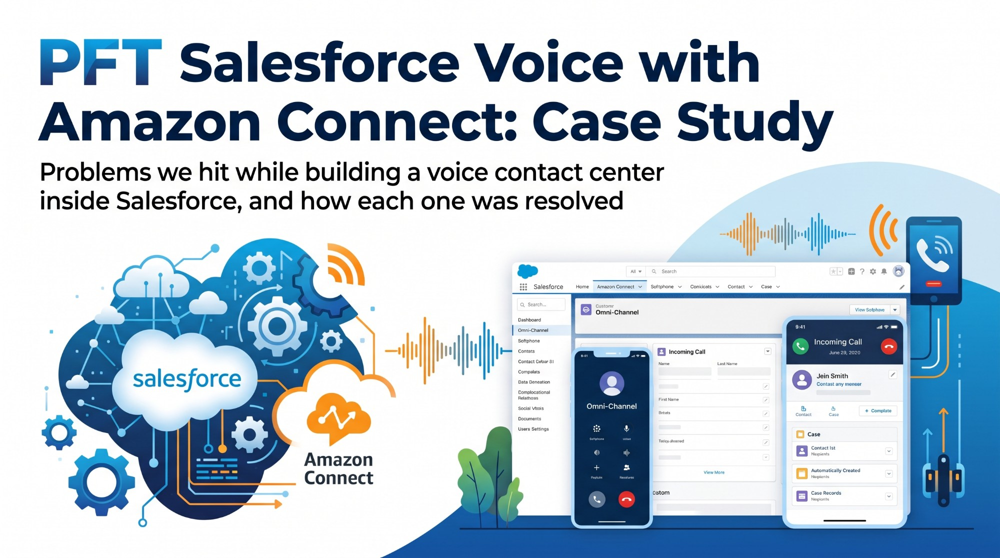

<section class="relative overflow-hidden bg-zinc-950 text-white">
  

  

    <a href="/case-studies.html" class="inline-flex min-h-11 items-center gap-2 text-sm font-medium text-zinc-300 transition hover:text-white focus-visible:outline-2 focus-visible:outline-offset-4 focus-visible:outline-white">
      <svg class="h-4 w-4" viewBox="0 0 24 24" fill="none" stroke="currentColor" stroke-width="2" stroke-linecap="round" stroke-linejoin="round" aria-hidden="true"><path d="M19 12H5"/><path d="m12 19-7-7 7-7"/></svg>
      Back to case studies
    </a>
    
Case study · Service Cloud Voice · Amazon Connect

    <h1 class="mt-5 max-w-4xl text-3xl font-semibold tracking-tight text-balance sm:text-4xl md:text-5xl lg:text-[3.25rem] lg:leading-[1.1]">PFT Salesforce Voice with Amazon Connect: Case Study</h1>
    
Problems we hit while building a voice contact center inside Salesforce, and how each one was resolved.

    

      <time datetime="2026-11-16">16 November 2026</time>
      TwinStack Team
    

  

</section>

<article>

<section class="bg-white">
  

    
  

</section>

<section class="bg-white">
  

    <h2 class="text-2xl font-semibold tracking-tight text-zinc-950 sm:text-3xl">Overview</h2>
    

      
PFT moved its phone operation into Salesforce using Service Cloud Voice bundled with Amazon Connect. Callers reach an Amazon Connect IVR, are routed to the right person or department, and every call appears in Salesforce as a Voice Call record linked to the caller's contact and, where appropriate, an automatically created case. Staff answer calls from the Omni-Channel softphone without leaving the Service Console.

      
The platform worked well from the start, but real use surfaced practical problems. Some were configuration questions (how do we change who answers a call?), some were access questions (how do field staff take calls on a phone?), and some were genuinely confusing behavior (why did a voicemail play, then stop?). This case study documents four of them. For each, it describes the situation, the diagnosis, the resolution, and the lesson worth keeping.

    

  

</section>

<section class="bg-zinc-50">
  

    <h2 class="text-2xl font-semibold tracking-tight text-zinc-950 sm:text-3xl">The solution at a glance</h2>
    

      <table class="w-full min-w-[32rem] text-left text-sm sm:text-base">
        <thead class="bg-zinc-100 text-zinc-950"><tr><th scope="col" class="px-4 py-3 font-semibold">Layer</th><th scope="col" class="px-4 py-3 font-semibold">What it does</th></tr></thead>
        <tbody class="divide-y divide-zinc-200 text-zinc-600">
          <tr><th scope="row" class="px-4 py-3 align-top font-semibold text-zinc-900">Amazon Connect IVR and flows</th><td class="px-4 py-3">Greets callers, checks hours of operation, lets callers choose a department, offers voicemail when no one is available</td></tr>
          <tr><th scope="row" class="px-4 py-3 align-top font-semibold text-zinc-900">Queues and routing profiles</th><td class="px-4 py-3">Decide which people can receive which calls</td></tr>
          <tr><th scope="row" class="px-4 py-3 align-top font-semibold text-zinc-900">Salesforce Service Cloud Voice</th><td class="px-4 py-3">Shows the softphone, creates Voice Call records, links the caller to a contact and a case</td></tr>
          <tr><th scope="row" class="px-4 py-3 align-top font-semibold text-zinc-900">Voicemail subflow</th><td class="px-4 py-3">Records the message, tags the Voice Call, and feeds the transcription pipeline</td></tr>
        </tbody>
      </table>
    

    
Office hours are Monday to Friday, 8 AM to 5 PM. After hours, callers hear an out-of-hours message. During hours, if no agent is available, the caller can leave a voicemail and a case is created automatically, depending on the department selected.

  

</section>

<section class="bg-white">
  

    
Problem 1

    <h2 class="mt-2 max-w-3xl text-2xl font-semibold tracking-tight text-zinc-950 sm:text-3xl">Changing who takes a call without touching the Amazon Connect flow</h2>

    <h3 class="mt-8 text-xl font-semibold text-zinc-950">The situation</h3>
    
The IVR menu sends callers to departments such as Information Officers, Human Resources, the Grievance Office, Staffer Representatives, and executive lines. Staff assignments change: someone goes on leave, a colleague covers a role, or a new employee joins. Treating each change as a flow edit inside Amazon Connect is slow, risky (a mistake in a flow affects every caller), and requires someone comfortable editing contact flows.

    <h3 class="mt-8 text-xl font-semibold text-zinc-950">The diagnosis</h3>
    
The flow does not decide which person answers. It decides which queue a call is transferred to. Which people receive calls from that queue is decided one layer lower, by each user's routing profile, which lists the queues that user works. The flow can stay frozen while the people behind each queue change freely.

    <h3 class="mt-8 text-xl font-semibold text-zinc-950">The resolution</h3>
    
Every IVR option points to a queue, and every user has their own routing profile with a default queue. The mapping, shown by role:

    

      <table class="w-full min-w-[34rem] text-left text-sm sm:text-base">
        <thead class="bg-zinc-100 text-zinc-950"><tr><th scope="col" class="px-4 py-3 font-semibold">User role</th><th scope="col" class="px-4 py-3 font-semibold">Routing profile</th><th scope="col" class="px-4 py-3 font-semibold">Default assigned queue</th></tr></thead>
        <tbody class="divide-y divide-zinc-200 text-zinc-600">
          <tr><td class="px-4 py-3">Information officer 1</td><td class="px-4 py-3">RP_Erik</td><td class="px-4 py-3">Information_Slot_1, HR_Fallback</td></tr>
          <tr><td class="px-4 py-3">Information officer 2</td><td class="px-4 py-3">RP_Ed</td><td class="px-4 py-3">Information_Slot_2</td></tr>
          <tr><td class="px-4 py-3">Information officer 3 / Grievance</td><td class="px-4 py-3">RP_denise</td><td class="px-4 py-3">Information_Slot_3, PFT Grievance Office</td></tr>
          <tr><td class="px-4 py-3">Human resources</td><td class="px-4 py-3">RP_Sharon</td><td class="px-4 py-3">PFT Human Resources</td></tr>
          <tr><td class="px-4 py-3">Staffer representatives 1 to 6</td><td class="px-4 py-3">RP_Staffer_1 to RP_Staffer_6</td><td class="px-4 py-3">Staffer_Rep_1 to Staffer_Rep_6</td></tr>
          <tr><td class="px-4 py-3">Political Director</td><td class="px-4 py-3">Political Director</td><td class="px-4 py-3">Political Director</td></tr>
          <tr><td class="px-4 py-3">Communications Director</td><td class="px-4 py-3">Communications Director</td><td class="px-4 py-3">Communications Director</td></tr>
        </tbody>
      </table>
    

    
Each IVR choice transfers to a queue:

    

      <table class="w-full min-w-[28rem] text-left text-sm sm:text-base">
        <thead class="bg-zinc-100 text-zinc-950"><tr><th scope="col" class="px-4 py-3 font-semibold">Queue</th><th scope="col" class="px-4 py-3 font-semibold">Reached from</th></tr></thead>
        <tbody class="divide-y divide-zinc-200 text-zinc-600">
          <tr><td class="px-4 py-3">Information_Slot_1, 2, 3</td><td class="px-4 py-3">Information Officers (IVR option 2)</td></tr>
          <tr><td class="px-4 py-3">PFT Human Resources</td><td class="px-4 py-3">HR (IVR option 3)</td></tr>
          <tr><td class="px-4 py-3">HR_Fallback</td><td class="px-4 py-3">If HR is unavailable (IVR option 3)</td></tr>
          <tr><td class="px-4 py-3">PFT Grievance Office</td><td class="px-4 py-3">Grievance Office (IVR option 4)</td></tr>
          <tr><td class="px-4 py-3">Staffer_Rep_1 to 6</td><td class="px-4 py-3">Staffer Representatives (IVR option 5)</td></tr>
          <tr><td class="px-4 py-3">PFT Voicemail</td><td class="px-4 py-3">Voicemail failsafe (IVR option 6)</td></tr>
        </tbody>
      </table>
    

    
To change who takes a call, an administrator opens the person's routing profile in Amazon Connect and changes the queue assigned to it. For example, to have a colleague answer HR calls while the HR lead is out, add the PFT Human Resources queue to that colleague's routing profile. The next call to that queue rings the new person. No flow was opened, edited, or republished.

    
The same design handles hours. Separate hours-of-operation records (one Information slot covering 8 AM to 9 AM, another 9 AM to 1 PM and 2 PM to 5 PM, and another covering the 1 PM to 2 PM lunch hour) let different people cover different parts of the day while callers still hear a single menu. New users are simple to add: create the user, assign any existing routing profile, and they begin receiving that profile's calls.

    
<strong class="font-semibold text-zinc-950">The lesson.</strong> Keep the flow stable and put the variability in the routing profiles. Flows describe the path a call takes; routing profiles describe who is available at the end of that path.

  

</section>

<section class="bg-zinc-50">
  

    
Problem 2

    <h2 class="mt-2 max-w-3xl text-2xl font-semibold tracking-tight text-zinc-950 sm:text-3xl">Letting standard users make voice calls from a mobile phone</h2>

    <h3 class="mt-8 text-xl font-semibold text-zinc-950">The situation</h3>
    
Field staff needed to place and receive calls with the Amazon Connect softphone from their phones, with the same benefits desk users get: caller lookup, a Voice Call record, an automatically created case, and the ability to work the case afterward. The org has two custom profiles, PFT System Admin and PFT Standard User, and the goal was to enable Service Cloud Voice for standard users so they could take calls without administrator rights.

    <h3 class="mt-8 text-xl font-semibold text-zinc-950">The diagnosis</h3>
    
There were two separate obstacles.

    
<strong class="font-semibold text-zinc-900">Access.</strong> Voice setup pages in Setup, including the Amazon Contact Centers page, were visible only to the System Admin profile. A standard user does not need to see them to take calls, but does need to be a member of the contact center, hold the voice permissions, and have a matching Amazon Connect user with a routing profile.

    
<strong class="font-semibold text-zinc-900">The phone itself.</strong> The Omni-Channel softphone behaves differently by platform:

    

      <table class="w-full min-w-[36rem] text-left text-sm sm:text-base">
        <thead class="bg-zinc-100 text-zinc-950"><tr><th scope="col" class="px-4 py-3 font-semibold">Factor</th><th scope="col" class="px-4 py-3 font-semibold">Android (Chrome)</th><th scope="col" class="px-4 py-3 font-semibold">iPhone (Safari and Chrome)</th></tr></thead>
        <tbody class="divide-y divide-zinc-200 text-zinc-600">
          <tr><th scope="row" class="px-4 py-3 align-top font-semibold text-zinc-900">Browser engine</th><td class="px-4 py-3">Blink (Chromium)</td><td class="px-4 py-3">WebKit (required by iOS for every browser)</td></tr>
          <tr><th scope="row" class="px-4 py-3 align-top font-semibold text-zinc-900">Third-party cookies</th><td class="px-4 py-3">Allowed or easily prompted</td><td class="px-4 py-3">Blocked by Intelligent Tracking Prevention</td></tr>
          <tr><th scope="row" class="px-4 py-3 align-top font-semibold text-zinc-900">Softphone sign-in</th><td class="px-4 py-3">Authenticates normally</td><td class="px-4 py-3">Single sign-on fails silently inside the Utility Bar iframe</td></tr>
          <tr><th scope="row" class="px-4 py-3 align-top font-semibold text-zinc-900">Audio and microphone</th><td class="px-4 py-3">Works in desktop mode</td><td class="px-4 py-3">Strict user-gesture rules block audio access</td></tr>
          <tr><th scope="row" class="px-4 py-3 align-top font-semibold text-zinc-900">Official support</th><td class="px-4 py-3">Works, though not formally supported</td><td class="px-4 py-3">Not supported</td></tr>
        </tbody>
      </table>
    

    
On Android, Lightning loads in the mobile browser once Desktop Mode is on (otherwise the Classic view appears), and the softphone, Voice Calls, and the Case subtab with its fields are all visible. On iPhone, every browser is a wrapper around Safari's WebKit, so switching browsers changes nothing. iPad is worse: Salesforce hides the Utility Bar there, and telephony providers support only desktop Chrome, Firefox, and Edge.

    <h3 class="mt-8 text-xl font-semibold text-zinc-950">The resolution</h3>
    <ul class="mt-4 max-w-3xl list-disc space-y-3 pl-6 text-lg leading-relaxed text-zinc-600">
      <li><strong class="font-semibold text-zinc-900">Enable the standard user for voice.</strong> Add the user to the contact center, assign the voice permissions, and create or link their Amazon Connect user with the appropriate routing profile (see Problem 1).</li>
      <li><strong class="font-semibold text-zinc-900">Android:</strong> open Salesforce in Chrome with Desktop Mode enabled and use the Omni-Channel softphone as on a desktop.</li>
      <li><strong class="font-semibold text-zinc-900">iPhone:</strong> log in to Amazon Connect through Salesforce so calls are handled outside the blocked iframe sign-in. In testing this works on iPhone: the app keeps running in the background, calls work with the screen off, cases are still created automatically, and case work is done in the Salesforce mobile app.</li>
      <li><strong class="font-semibold text-zinc-900">Tablets:</strong> use a touch-enabled Windows tablet (such as a Surface Pro) or an Android tablet with Chrome in desktop mode. iPad is not workable.</li>
    </ul>
    
A commercial fallback also exists: a marketplace mobile app for Amazon Connect at roughly $29.99 per user per month, with a ten-user minimum and a trial available. We kept it in reserve since the Salesforce-based login met the requirement without extra license cost.

    
For the step-by-step version, see our guide to <a href="/blog/salesforce-voice-mobile-iphone-android.html" class="font-medium text-zinc-950 underline decoration-brand decoration-2 underline-offset-4 transition hover:text-brand">Salesforce Voice on mobile: calls on iPhone and Android</a>.

    
<strong class="font-semibold text-zinc-950">The lesson.</strong> The iPhone limitation is a platform rule, not a misconfiguration, so the answer is a different entry point, not more troubleshooting. Document the supported device for each type of user.

  

</section>

<section class="bg-white">
  

    
Problem 3

    <h2 class="mt-2 max-w-3xl text-2xl font-semibold tracking-tight text-zinc-950 sm:text-3xl">Cookies, and logging in as a second account</h2>

    <h3 class="mt-8 text-xl font-semibold text-zinc-950">The situation</h3>
    
While testing, we signed into a different Salesforce account in the same browser without clearing site data, and Amazon Connect kept showing the previous account's users. It looked like a permissions problem or an out-of-date sync.

    <h3 class="mt-8 text-xl font-semibold text-zinc-950">The diagnosis</h3>
    
It was neither. It was saved login data in the browser. Amazon Connect relies on cookies for its login session, and the browser still held the first account's session, so Amazon Connect kept treating it as the earlier identity. The same dependency explains why third-party cookies matter: Amazon Connect runs on a different domain from Salesforce, and if the browser blocks third-party cookies the login can fail without an obvious error. The confirming test is simple: the problem disappears in a clean browser session.

    <h3 class="mt-8 text-xl font-semibold text-zinc-950">The resolution</h3>
    <ul class="mt-4 max-w-3xl list-disc space-y-3 pl-6 text-lg leading-relaxed text-zinc-600">
      <li>Clear cookies and site data for the site.</li>
      <li>Enable third-party cookies, because Amazon Connect relies on them for login.</li>
      <li>If you switch between Salesforce accounts regularly, use a separate browser profile for each account so the sessions never overlap.</li>
    </ul>

    
<strong class="font-semibold text-zinc-950">The lesson.</strong> When the data on screen belongs to the wrong account, suspect the session before the permissions. Try the same action in a private window or fresh browser profile first. If it behaves correctly there, you have confirmed it is saved login data.

  

</section>

<section class="bg-zinc-50">
  

    
Problem 4

    <h2 class="mt-2 max-w-3xl text-2xl font-semibold tracking-tight text-zinc-950 sm:text-3xl">Voicemail recordings that play, then stop playing</h2>

    <h3 class="mt-8 text-xl font-semibold text-zinc-950">The situation</h3>
    
A voicemail was playable in Salesforce right after the call. Once it finished processing, it stopped playing, and the player showed only "We can't load the recording. Try again later." This was alarming because the audio had clearly been captured: it had played minutes earlier.

    <h3 class="mt-8 text-xl font-semibold text-zinc-950">The diagnosis</h3>
    
The first clue was in the data. At the exact moment playback broke, the owner of the Voice Call record changed from an automated system user to the Voicemail queue. That change is part of post-call processing, which suggested processing was also changing which audio file the player was pointed at.

    
The second clue came from comparing against an earlier project where playback worked. In the Amazon Connect settings under Enable conversational analytics, the broken build had Automated interaction analytics switched on. The working build had only Real-time and post-contact analytics selected.

    
The explanation fits both clues. A voicemail never reaches an agent, so Amazon Connect treats it as an automated interaction and stores its recording separately from agent call recordings. With Automated interaction analytics on, a different file was produced than the one the Salesforce player was looking for. The player was not broken; it was asking for a file that was no longer the one that existed.

    <h3 class="mt-8 text-xl font-semibold text-zinc-950">The resolution</h3>
    
Turn Automated interaction analytics off, keeping Real-time and post-contact analytics. After the change, voicemails kept playing after processing finished.

    
<strong class="font-semibold text-zinc-950">The lesson.</strong> Two habits solved this. First, watch what else changes at the moment something breaks (here, the record owner). Second, when an earlier build worked, compare settings side by side rather than debugging the broken one in isolation. One toggle that looks unrelated to playback was the entire cause.

    <h3 class="mt-12 text-xl font-semibold text-zinc-950">Related open item: voicemail that times out</h3>
    
Voicemail uses a dedicated Connect subflow with a 170-second recording window. When a caller presses a key to finish, the Voice Call completes with a duration and a transcript. When the window instead runs out, the Voice Call stays in the New state with no duration and no transcript. This is under investigation. Like Problem 4, the recording exists but post-call processing does not complete on the normal path.

  

</section>

<section class="bg-white">
  

    <h2 class="text-2xl font-semibold tracking-tight text-zinc-950 sm:text-3xl">Summary of problems and fixes</h2>
    

      <table class="w-full min-w-[40rem] text-left text-sm sm:text-base">
        <thead class="bg-zinc-100 text-zinc-950"><tr><th scope="col" class="px-4 py-3 font-semibold">#</th><th scope="col" class="px-4 py-3 font-semibold">Problem</th><th scope="col" class="px-4 py-3 font-semibold">Root cause</th><th scope="col" class="px-4 py-3 font-semibold">Fix</th></tr></thead>
        <tbody class="divide-y divide-zinc-200 text-zinc-600">
          <tr><td class="px-4 py-3 font-semibold text-zinc-900">1</td><td class="px-4 py-3">Change who takes a call</td><td class="px-4 py-3">People are set by routing profiles, not flows</td><td class="px-4 py-3">Change the queue on the routing profile</td></tr>
          <tr><td class="px-4 py-3 font-semibold text-zinc-900">2</td><td class="px-4 py-3">Standard users calling from mobile</td><td class="px-4 py-3">Voice access setup plus WebKit limits on iPhone</td><td class="px-4 py-3">Enable voice for the user; Android desktop mode; Salesforce-based Connect login on iPhone</td></tr>
          <tr><td class="px-4 py-3 font-semibold text-zinc-900">3</td><td class="px-4 py-3">Connect shows the wrong account's users</td><td class="px-4 py-3">Saved login data and cookies</td><td class="px-4 py-3">Clear site data, enable third-party cookies, one browser profile per account</td></tr>
          <tr><td class="px-4 py-3 font-semibold text-zinc-900">4</td><td class="px-4 py-3">Voicemail plays, then stops</td><td class="px-4 py-3">Automated interaction analytics stored a different recording file</td><td class="px-4 py-3">Turn Automated interaction analytics off</td></tr>
        </tbody>
      </table>
    

  

</section>

<section class="bg-zinc-950 text-white">
  

    <h2 class="text-2xl font-semibold tracking-tight sm:text-3xl">Key takeaways</h2>
    

      
<h3 class="font-semibold">Separate the path from the people</h3>
Flows stay stable; routing profiles carry staffing changes.

      
<h3 class="font-semibold">Know the device matrix</h3>
Desktop and Android work; iPhone needs a different entry point; iPad is not supported.

      
<h3 class="font-semibold">Suspect the session first</h3>
Many "wrong data" symptoms are cookies, not permissions.

      
<h3 class="font-semibold">Compare with a working build</h3>
One analytics setting explained a failure that looked like a Salesforce problem.

    

  

</section>

<section class="bg-white">
  

    

      

      

        <h2 class="text-2xl font-semibold tracking-tight text-balance sm:text-3xl">Building a voice contact center in Salesforce?</h2>
        
We can help you set up Service Cloud Voice with Amazon Connect and avoid the problems above.

        <a href="/contact.html" class="mt-8 inline-flex min-h-12 items-center gap-2 rounded-lg bg-brand px-6 py-3 font-semibold text-white shadow-lg shadow-brand/30 transition hover:-translate-y-0.5 hover:shadow-xl focus-visible:outline-2 focus-visible:outline-offset-4 focus-visible:outline-white">Talk to our Salesforce team</a>
      

    

    

      <a href="/case-studies.html" class="inline-flex min-h-11 items-center gap-2 font-medium text-zinc-950 underline decoration-brand decoration-2 underline-offset-4 transition hover:text-brand focus-visible:outline-2 focus-visible:outline-offset-4 focus-visible:outline-brand">Return to all case studies</a>
    

  

</section>

</article>

