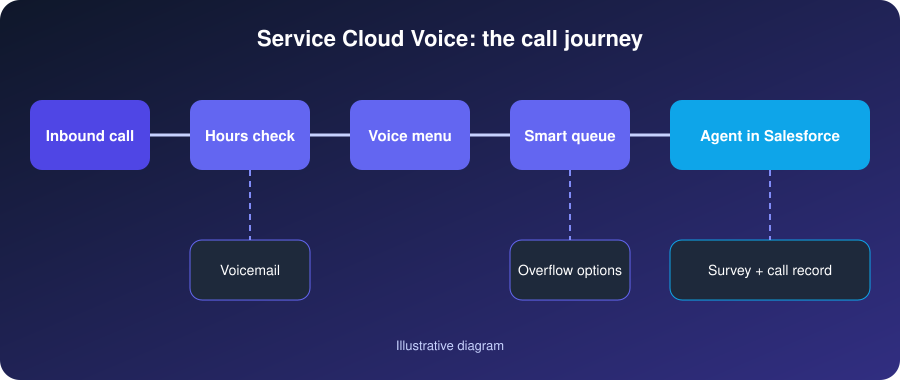

<section class="relative overflow-hidden bg-zinc-950 text-white">
  

  

  

    <a href="/case-studies.html" class="inline-flex min-h-11 items-center gap-2 text-sm font-medium text-zinc-300 transition hover:text-white focus-visible:outline-2 focus-visible:outline-offset-4 focus-visible:outline-white">
      <svg class="h-4 w-4" viewBox="0 0 24 24" fill="none" stroke="currentColor" stroke-width="2" stroke-linecap="round" stroke-linejoin="round" aria-hidden="true"><path d="M19 12H5"/><path d="m12 19-7-7 7-7"/></svg>
      Back to case studies
    </a>
    
Case study · Service Cloud Voice

    <h1 class="mt-5 max-w-4xl text-3xl font-semibold tracking-tight text-balance sm:text-4xl md:text-5xl lg:text-[3.25rem] lg:leading-[1.1]">Salesforce Service Cloud Voice: Unifying Phone Support and CRM in One Agent Workspace</h1>
    
How a public-benefit family support helpline moved its phone line into Salesforce, so every call, voicemail and survey answer sits on the same record as the person it belongs to.

    

      
        <svg class="h-4 w-4" viewBox="0 0 24 24" fill="none" stroke="currentColor" stroke-width="2" stroke-linecap="round" stroke-linejoin="round" aria-hidden="true"><rect x="3" y="4" width="18" height="18" rx="2"/><path d="M16 2v4M8 2v4M3 10h18"/></svg>
        <time datetime="2026-11-10">10 November 2026</time>
      
      
        <svg class="h-4 w-4" viewBox="0 0 24 24" fill="none" stroke="currentColor" stroke-width="2" stroke-linecap="round" stroke-linejoin="round" aria-hidden="true"><path d="M20 21v-2a4 4 0 0 0-4-4H8a4 4 0 0 0-4 4v2"/><circle cx="12" cy="7" r="4"/></svg>
        TwinStack Team
      
    

  

</section>

<article>

<section class="bg-white">
  

    

      

        <h2 class="text-2xl font-semibold tracking-tight text-zinc-950 sm:text-3xl">Executive summary</h2>
        
A public-benefit family support helpline ran its phone line on a system that sat apart from its CRM. Agents switched between tools during every call, and the history of a conversation lived in two places.

        
We brought the phone line into Salesforce with <strong class="font-semibold text-zinc-900">Salesforce Service Cloud Voice</strong>, connected to cloud contact-centre telephony. A call record is now created in Salesforce the moment a call arrives. Hours of operation, queue availability, voicemail, extension transfers and a short post-call survey are handled by designed call flows, and agents work from a single screen.

      

      <aside class="self-start rounded-2xl border border-zinc-200 bg-zinc-50 p-1 shadow-sm" aria-labelledby="glance-heading">
        

          <h2 id="glance-heading" class="text-lg font-semibold tracking-tight text-zinc-950">At a glance</h2>
          

            <table class="w-full min-w-[18rem] text-left text-sm">
              <tbody class="divide-y divide-zinc-200">
                <tr>
                  <th scope="row" class="py-3 pr-4 align-top font-semibold text-zinc-900">Industry</th>
                  <td class="py-3 text-zinc-600">Public-benefit support helpline</td>
                </tr>
                <tr>
                  <th scope="row" class="py-3 pr-4 align-top font-semibold text-zinc-900">Salesforce</th>
                  <td class="py-3 text-zinc-600">Service Cloud + Service Cloud Voice with cloud contact-centre telephony</td>
                </tr>
                <tr>
                  <th scope="row" class="py-3 pr-4 align-top font-semibold text-zinc-900">Channels</th>
                  <td class="py-3 text-zinc-600">Voice, voicemail, post-call survey</td>
                </tr>
              </tbody>
            </table>
          

        

      </aside>
    

  

</section>

<section class="bg-zinc-50">
  

    <h2 class="max-w-3xl text-2xl font-semibold tracking-tight text-zinc-950 sm:text-3xl">The business challenge: a phone system cut off from the CRM</h2>
    
The helpline supports families, so every call matters and context matters even more. The existing setup made both harder than they needed to be.

    <ul class="mt-10 grid gap-4 sm:grid-cols-2">
      <li class="rounded-2xl border border-zinc-200 bg-white p-5 shadow-sm">
        <h3 class="font-semibold text-zinc-950">Two disconnected systems</h3>
        
The phone system was separate from the CRM, so the call and the person's record never met.

      </li>
      <li class="rounded-2xl border border-zinc-200 bg-white p-5 shadow-sm">
        <h3 class="font-semibold text-zinc-950">Constant tool switching</h3>
        
Agents moved between tools mid-call to look up details and type notes.

      </li>
      <li class="rounded-2xl border border-zinc-200 bg-white p-5 shadow-sm">
        <h3 class="font-semibold text-zinc-950">Calls missing from cases</h3>
        
Calls were not reliably recorded against cases, so the history of a conversation was incomplete.

      </li>
      <li class="rounded-2xl border border-zinc-200 bg-white p-5 shadow-sm">
        <h3 class="font-semibold text-zinc-950">Out-of-hours calls lost</h3>
        
Callers who rang outside opening hours had no way to leave a message that reached the team.

      </li>
      <li class="rounded-2xl border border-zinc-200 bg-white p-5 shadow-sm">
        <h3 class="font-semibold text-zinc-950">No view of busy queues</h3>
        
Supervisors could not see when queues were busy or who was available to take a call.

      </li>
      <li class="rounded-2xl border border-zinc-200 bg-white p-5 shadow-sm">
        <h3 class="font-semibold text-zinc-950">No feedback loop</h3>
        
There was no structured way to ask callers how the call went, or to act on the answer.

      </li>
      <li class="rounded-2xl border border-zinc-200 bg-white p-5 shadow-sm sm:col-span-2">
        <h3 class="font-semibold text-zinc-950">Manual extension routing</h3>
        
Callers who knew who they needed relied on manual routing to an extension, which depended on whoever picked up first.

      </li>
    </ul>
  

</section>

<section class="bg-white">
  

    <h2 class="max-w-3xl text-2xl font-semibold tracking-tight text-zinc-950 sm:text-3xl">The solution: Service Cloud Voice inside the agent workspace</h2>
    
We implemented Salesforce Service Cloud Voice so that calls are handled inside the same console agents already use for cases. When a call arrives, a serverless function creates the call record in Salesforce straight away. The agent sees the call, the caller's record and the related case together, without leaving the workspace.

    
Calls are recorded, and real-time sentiment analytics give supervisors a read on how conversations are going. Everything that happens before an agent answers, and after the call ends, is handled by purpose-built call flows.

    <h3 class="mt-12 text-xl font-semibold tracking-tight text-zinc-950">How a call moves through the system</h3>
    <figure class="mt-5">
      

        
      

      <figcaption class="mt-3 text-sm leading-relaxed text-zinc-600">Call flow from first ring to post-call survey, with the call record held in Salesforce throughout.</figcaption>
    </figure>

    <h3 class="mt-12 text-xl font-semibold tracking-tight text-zinc-950">See the agent experience</h3>
    <figure class="mt-5">
      

        <video class="h-full w-full object-contain" controls preload="metadata" playsinline>
          <source src="/assets/files/service-cloud-voice-demo.mp4" type="video/mp4">
          Your browser does not support embedded video. <a href="/assets/files/service-cloud-voice-demo.mp4">Download the walkthrough video</a>.
        </video>
      

      <figcaption class="mt-3 text-sm leading-relaxed text-zinc-600">Walkthrough of the voice experience inside Salesforce</figcaption>
    </figure>
  

</section>

<section class="bg-zinc-950 text-white">
  

    <h2 class="max-w-3xl text-2xl font-semibold tracking-tight sm:text-3xl">Key features of the Service Cloud Voice implementation</h2>
    
Each feature handles one moment in the call, so callers get a clear path and agents only take calls they can help with.

    

      

        <h3 class="font-semibold">Hours-of-operation check</h3>
        
Each call is checked against opening hours. Outside them, the caller hears an out-of-hours message and can leave a voicemail.

      

      

        <h3 class="font-semibold">Greeting and keypad menu</h3>
        
A greeting leads into a keypad menu: next available agent, individual agent queues, a language-specific option, voicemail, extension dialling, and a repeat-options choice.

      

      

        <h3 class="font-semibold">Agent-availability check</h3>
        
Availability is checked before routing. If everyone is busy, a busy message offers voicemail rather than leaving the caller waiting.

      

      

        <h3 class="font-semibold">Voicemail subflow</h3>
        
Voicemail messages are routed into a follow-up queue in Salesforce, so each one is picked up and tracked like any other piece of work.

      

      

        <h3 class="font-semibold">Extension transfer</h3>
        
Callers who know their extension can dial it. The entry is validated, and a wrong number leads to a friendly fallback instead of a dead end.

      

      

        <h3 class="font-semibold">Post-call survey</h3>
        
A two-question automated survey runs after the call, and the answers are written back to the call record in Salesforce.

      

      

        <h3 class="font-semibold">Call recording and sentiment analytics</h3>
        
Calls are recorded against the call record, and real-time sentiment analytics help supervisors and agents see how a conversation is going while it is happening.

      

    

  

</section>

<section class="bg-white">
  

    <h2 class="max-w-3xl text-2xl font-semibold tracking-tight text-zinc-950 sm:text-3xl">Implementation overview: from call mapping to go-live</h2>
    
The work followed the call journey, from first design through to monitoring once the line was live. It is the same shape as our wider <a href="/services/salesforce-implementation.html" class="font-medium text-zinc-950 underline decoration-brand decoration-2 underline-offset-4 transition hover:text-brand focus-visible:outline-2 focus-visible:outline-offset-2 focus-visible:outline-brand">Salesforce implementation</a> approach.

    <ol class="mt-10 space-y-0">
      <li class="relative flex gap-5 pb-8 last:pb-0">
        
        1
        
<h3 class="font-semibold text-zinc-950">Map call journeys</h3>
Document how callers reach the helpline today and what each type of call needs to happen next.

      </li>
      <li class="relative flex gap-5 pb-8 last:pb-0">
        
        2
        
<h3 class="font-semibold text-zinc-950">Configure Service Cloud Voice and telephony</h3>
Set up Service Cloud Voice and connect it to the cloud contact-centre telephony.

      </li>
      <li class="relative flex gap-5 pb-8 last:pb-0">
        
        3
        
<h3 class="font-semibold text-zinc-950">Build the call flows</h3>
Create the main inbound flow, the voicemail subflow and the survey flow.

      </li>
      <li class="relative flex gap-5 pb-8 last:pb-0">
        
        4
        
<h3 class="font-semibold text-zinc-950">Connect flows to Salesforce</h3>
Use serverless functions to create call records and write survey answers back, an integration pattern we cover under <a href="/services/salesforce-integrations.html" class="font-medium text-zinc-950 underline decoration-brand decoration-2 underline-offset-4 transition hover:text-brand focus-visible:outline-2 focus-visible:outline-offset-2 focus-visible:outline-brand">Salesforce integrations</a>.

      </li>
      <li class="relative flex gap-5 pb-8 last:pb-0">
        
        5
        
<h3 class="font-semibold text-zinc-950">Set queues, hours and routing</h3>
Define the queues, opening hours and routing rules the flows rely on.

      </li>
      <li class="relative flex gap-5 pb-8 last:pb-0">
        
        6
        
<h3 class="font-semibold text-zinc-950">Test the edge cases</h3>
Try calls after hours, with a busy queue, with a wrong extension and with errors in each connected step.

      </li>
      <li class="relative flex gap-5 pb-8 last:pb-0">
        
        7
        
<h3 class="font-semibold text-zinc-950">Train agents and go live</h3>
Walk agents and supervisors through the new workspace, then switch the line over.

      </li>
      <li class="relative flex gap-5">
        8
        
<h3 class="font-semibold text-zinc-950">Monitor and refine</h3>
Review call records, survey answers and queue behaviour, and adjust the flows as the team learns.

      </li>
    </ol>
  

</section>

<section class="bg-zinc-50">
  

    <h2 class="max-w-3xl text-2xl font-semibold tracking-tight text-zinc-950 sm:text-3xl">Service Cloud Voice use cases</h2>
    
The same pattern suits any team that takes calls and needs them tied to customer or constituent records.

    

      

        <h3 class="font-semibold text-zinc-950">Customer help desks</h3>
        
Calls arrive with the customer's cases and history already on screen.

      

      

        <h3 class="font-semibold text-zinc-950">Nonprofit and public-sector helplines</h3>
        
Sensitive conversations are recorded against the right case, with a clear trail for follow-up. See our <a href="/services/salesforce-nonprofit.html" class="font-medium text-zinc-950 underline decoration-brand decoration-2 underline-offset-4 transition hover:text-brand focus-visible:outline-2 focus-visible:outline-offset-2 focus-visible:outline-brand">Salesforce for nonprofits</a> work.

      

      

        <h3 class="font-semibold text-zinc-950">Multilingual routing</h3>
        
A language option sends callers to agents who speak their language.

      

      

        <h3 class="font-semibold text-zinc-950">Office-hours teams</h3>
        
Out-of-hours messages and voicemail keep after-hours calls from disappearing.

      

      

        <h3 class="font-semibold text-zinc-950">Feedback and quality monitoring</h3>
        
Post-call surveys and sentiment data feed coaching and service reviews.

      

    

  

</section>

<section class="bg-white">
  

    

      

        <h2 class="text-2xl font-semibold tracking-tight text-zinc-950 sm:text-3xl">Benefits of unifying voice and CRM</h2>
        
We describe the results by what changed for agents, supervisors and callers, rather than by figures.

      

      <ul class="space-y-4">
        <li class="flex gap-3"><svg class="mt-1 h-5 w-5 shrink-0 text-brand" viewBox="0 0 24 24" fill="none" stroke="currentColor" stroke-width="2.5" stroke-linecap="round" stroke-linejoin="round" aria-hidden="true"><path d="M20 6 9 17l-5-5"/></svg><strong class="font-semibold text-zinc-950">A single agent workspace.</strong> Calls, cases and records sit on one screen.</li>
        <li class="flex gap-3"><svg class="mt-1 h-5 w-5 shrink-0 text-brand" viewBox="0 0 24 24" fill="none" stroke="currentColor" stroke-width="2.5" stroke-linecap="round" stroke-linejoin="round" aria-hidden="true"><path d="M20 6 9 17l-5-5"/></svg><strong class="font-semibold text-zinc-950">Instant context.</strong> The call record exists the moment the call arrives.</li>
        <li class="flex gap-3"><svg class="mt-1 h-5 w-5 shrink-0 text-brand" viewBox="0 0 24 24" fill="none" stroke="currentColor" stroke-width="2.5" stroke-linecap="round" stroke-linejoin="round" aria-hidden="true"><path d="M20 6 9 17l-5-5"/></svg><strong class="font-semibold text-zinc-950">No lost after-hours calls.</strong> Voicemail lands in a follow-up queue.</li>
        <li class="flex gap-3"><svg class="mt-1 h-5 w-5 shrink-0 text-brand" viewBox="0 0 24 24" fill="none" stroke="currentColor" stroke-width="2.5" stroke-linecap="round" stroke-linejoin="round" aria-hidden="true"><path d="M20 6 9 17l-5-5"/></svg><strong class="font-semibold text-zinc-950">Smarter routing.</strong> Availability, language and extension choices guide each call.</li>
        <li class="flex gap-3"><svg class="mt-1 h-5 w-5 shrink-0 text-brand" viewBox="0 0 24 24" fill="none" stroke="currentColor" stroke-width="2.5" stroke-linecap="round" stroke-linejoin="round" aria-hidden="true"><path d="M20 6 9 17l-5-5"/></svg><strong class="font-semibold text-zinc-950">Measurable feedback.</strong> Survey answers are stored with the call they relate to.</li>
        <li class="flex gap-3"><svg class="mt-1 h-5 w-5 shrink-0 text-brand" viewBox="0 0 24 24" fill="none" stroke="currentColor" stroke-width="2.5" stroke-linecap="round" stroke-linejoin="round" aria-hidden="true"><path d="M20 6 9 17l-5-5"/></svg><strong class="font-semibold text-zinc-950">Supervisor visibility.</strong> Queues, availability and sentiment are easier to see.</li>
        <li class="flex gap-3"><svg class="mt-1 h-5 w-5 shrink-0 text-brand" viewBox="0 0 24 24" fill="none" stroke="currentColor" stroke-width="2.5" stroke-linecap="round" stroke-linejoin="round" aria-hidden="true"><path d="M20 6 9 17l-5-5"/></svg><strong class="font-semibold text-zinc-950">Auditable call history.</strong> Recordings and call records give a trail to review.</li>
      </ul>
    

  

</section>

<section class="bg-zinc-50">
  

    <h2 class="text-2xl font-semibold tracking-tight text-zinc-950 sm:text-3xl">Lessons learned from the Service Cloud Voice rollout</h2>
    

      

        <h3 class="text-lg font-semibold text-zinc-950">Design the call journey before the configuration</h3>
        
Mapping what each caller needs made the flows simpler to build and easier for the team to explain and maintain.

      

      

        <h3 class="text-lg font-semibold text-zinc-950">Plan for the unhappy paths</h3>
        
After-hours calls, busy queues, wrong extensions and connection errors are where callers get lost. Each needs a clear, friendly outcome.

      

      

        <h3 class="text-lg font-semibold text-zinc-950">Keep surveys short</h3>
        
Two questions is enough to start a feedback loop without asking too much of callers.

      

      

        <h3 class="text-lg font-semibold text-zinc-950">Treat go-live as the start of tuning</h3>
        
Real calls show which menu options, messages and queues need adjusting, so monitoring and refinement belong in the plan.

      

    

  

</section>

<section class="bg-white">
  

    <h2 class="text-2xl font-semibold tracking-tight text-zinc-950 sm:text-3xl">Service Cloud Voice FAQ</h2>
    

      

        

          What is Salesforce Service Cloud Voice?
          <svg class="h-5 w-5 shrink-0 text-zinc-500 transition group-open:rotate-180" viewBox="0 0 24 24" fill="none" stroke="currentColor" stroke-width="2" stroke-linecap="round" stroke-linejoin="round" aria-hidden="true"><path d="m6 9 6 6 6-6"/></svg>
        

        
Service Cloud Voice brings phone calls into Salesforce Service Cloud. Agents take and manage calls in the same workspace as their cases and records, and each call is logged against a call record in Salesforce.

      

      

        

          How long does a Service Cloud Voice implementation take?
          <svg class="h-5 w-5 shrink-0 text-zinc-500 transition group-open:rotate-180" viewBox="0 0 24 24" fill="none" stroke="currentColor" stroke-width="2" stroke-linecap="round" stroke-linejoin="round" aria-hidden="true"><path d="m6 9 6 6 6-6"/></svg>
        

        
It depends on scope. The number of queues, languages, menu options and integrations all change the effort, so we agree a plan after mapping your call journeys rather than quoting a fixed duration.

      

      

        

          Does Service Cloud Voice need a telephony provider?
          <svg class="h-5 w-5 shrink-0 text-zinc-500 transition group-open:rotate-180" viewBox="0 0 24 24" fill="none" stroke="currentColor" stroke-width="2" stroke-linecap="round" stroke-linejoin="round" aria-hidden="true"><path d="m6 9 6 6 6-6"/></svg>
        

        
Yes. Service Cloud Voice works with a telephony system that carries the calls. In this project that was cloud contact-centre telephony, connected to Salesforce.

      

      

        

          Can Service Cloud Voice capture post-call surveys?
          <svg class="h-5 w-5 shrink-0 text-zinc-500 transition group-open:rotate-180" viewBox="0 0 24 24" fill="none" stroke="currentColor" stroke-width="2" stroke-linecap="round" stroke-linejoin="round" aria-hidden="true"><path d="m6 9 6 6 6-6"/></svg>
        

        
Yes. Here, a short automated survey runs after the call and the answers are written back to the call record in Salesforce, so feedback sits next to the conversation it describes.

      

    

  

</section>

<section class="bg-white">
  

    

      <strong class="font-semibold text-zinc-950">Note:</strong> Illustrative case study. Details are anonymised and generalised; no client information is disclosed.
    

  

</section>

<section class="bg-white">
  

    

      

      

        <h2 class="text-2xl font-semibold tracking-tight text-balance sm:text-3xl">Bring your phone support into Salesforce</h2>
        
If your agents still switch between a phone system and the CRM, we can map your call journeys and show what a single workspace would look like for your team.

        <a href="/contact.html" class="mt-8 inline-flex min-h-12 items-center gap-2 rounded-lg bg-brand px-6 py-3 font-semibold text-white shadow-lg shadow-brand/30 transition hover:-translate-y-0.5 hover:shadow-xl focus-visible:outline-2 focus-visible:outline-offset-4 focus-visible:outline-white">
          Talk to our Salesforce team
          <svg class="h-4 w-4" viewBox="0 0 24 24" fill="none" stroke="currentColor" stroke-width="2" stroke-linecap="round" stroke-linejoin="round" aria-hidden="true"><path d="M5 12h14"/><path d="m12 5 7 7-7 7"/></svg>
        </a>
      

    

    

      <a href="/case-studies.html" class="inline-flex min-h-11 items-center gap-2 font-medium text-zinc-950 underline decoration-brand decoration-2 underline-offset-4 transition hover:text-brand focus-visible:outline-2 focus-visible:outline-offset-4 focus-visible:outline-brand">
        <svg class="h-4 w-4" viewBox="0 0 24 24" fill="none" stroke="currentColor" stroke-width="2" stroke-linecap="round" stroke-linejoin="round" aria-hidden="true"><path d="M19 12H5"/><path d="m12 19-7-7 7-7"/></svg>
        Return to all case studies
      </a>
    

  

</section>

</article>

