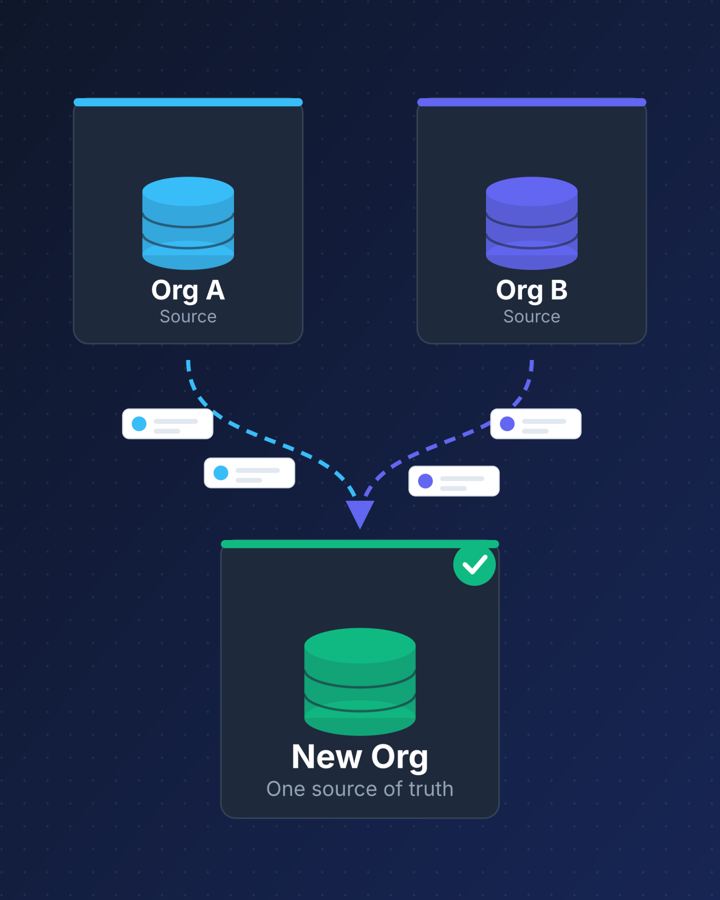
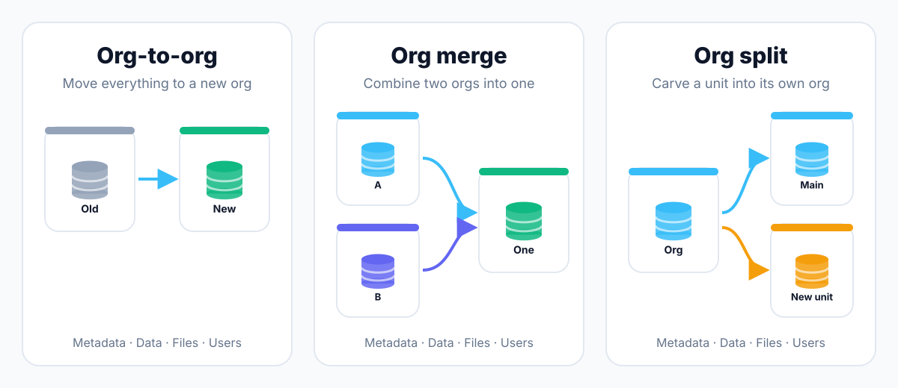
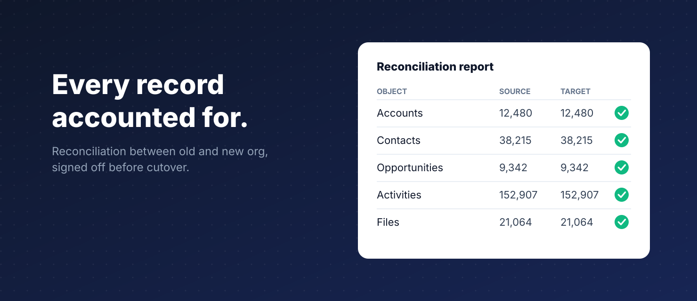

<svg xmlns="http://www.w3.org/2000/svg" style="display:none" aria-hidden="true"><symbol id="i-arrow-left" viewBox="0 0 512 512"><path d="M232 96L72 256l160 160 45-45-83-83h254v-64H194l83-83z" /></symbol><symbol id="i-arrow-right" viewBox="0 0 512 512"><path d="M280 96l160 160-160 160-45-45 83-83H64v-64h254l-83-83z" /></symbol><symbol id="i-times" viewBox="0 0 512 512"><path d="M312 256l142 142-56 56-142-142-142 142-56-56 142-142L58 114l56-56 142 142L398 58l56 56z" /></symbol><symbol id="i-bars" viewBox="0 0 512 512"><path d="M48 96h416v56H48zm0 132h416v56H48zm0 132h416v56H48z" /></symbol></svg>
<nav id="navbar" class="imp-fixed imp-z-50 imp-top-6 imp-left-1/2 imp--translate-x-1/2 imp-w-[95%] imp-max-w-7xl imp-rounded-2xl imp-bg-white imp-border imp-border-slate-100 imp-shadow-2xl imp-flex imp-justify-between imp-items-center imp-px-6 imp-lg:px-8 imp-h-20 imp-transition-all imp-duration-300">
        <a href="/" class="imp-flex-shrink-0 imp-flex imp-items-center imp-gap-2">
            
            TwinStackSolutions
        </a>
        

            <a href="/pricing.html" class="imp-text-slate-600 imp-hover:text-brand-600 imp-font-medium imp-transition">Pricing</a>
            
<a href="/services.html" class="imp-text-brand-600 imp-font-bold imp-transition" aria-haspopup="true">Products &amp; Services<svg class="imp-ts-dd-car" viewBox="0 0 12 12" aria-hidden="true"><path d="M2.5 4.5 6 8l3.5-3.5" fill="none" stroke="currentColor" stroke-width="1.6" stroke-linecap="round" stroke-linejoin="round" /></svg></a>
<a href="/products.html">Products<small>Free native AppExchange apps</small></a><a href="/services.html">Services<small>Consulting, nonprofits, Tableau and more</small></a><a href="/#pdo-journey">Expertise<small>Our path from strategy to AppExchange</small></a>

            <a href="/case-studies.html" class="imp-text-slate-600 imp-hover:text-brand-600 imp-font-medium imp-transition">Case Studies</a>
            <a href="/blog.html" class="imp-text-slate-600 imp-hover:text-brand-600 imp-font-medium imp-transition">Blog</a>
            <a href="/cost-estimator.html" class="imp-ts-btn-outline">Cost Estimator</a>
            <a href="/contact.html" class="imp-px-5 imp-py-2.5 imp-rounded-full imp-bg-brand-600 imp-text-white imp-font-semibold imp-hover:bg-brand-900 imp-transition imp-shadow-lg">Contact Us</a>
        

        

            <button id="mobile-menu-btn" class="imp-text-slate-600 imp-p-2"><svg class="imp-svgi imp-text-2xl" aria-hidden="true"><use href="#i-bars" /></svg></button>
        

    </nav>

        
<button id="close-menu-btn" class="imp-text-slate-500"><svg class="imp-svgi imp-text-2xl" aria-hidden="true"><use href="#i-times" /></svg></button>

        

            <a href="/" class="imp-text-lg imp-font-medium imp-text-slate-800 imp-hover:text-brand-600">Home</a>
            <a href="/about.html" class="imp-text-lg imp-font-medium imp-text-slate-800 imp-hover:text-brand-600">About</a>
            <a href="/pricing.html" class="imp-text-lg imp-font-medium imp-text-slate-800 imp-hover:text-brand-600">Pricing</a>
            <a href="/products.html" class="imp-text-lg imp-font-medium imp-text-slate-800 imp-hover:text-brand-600">Products</a>
            <a href="/services.html" class="imp-text-lg imp-font-medium imp-text-slate-800 imp-hover:text-brand-600">Services</a>
            <a href="/#pdo-journey" class="imp-text-lg imp-font-medium imp-text-slate-800 imp-hover:text-brand-600">Expertise</a>
            <a href="/case-studies.html" class="imp-text-lg imp-font-medium imp-text-slate-800 imp-hover:text-brand-600">Case Studies</a>
            <a href="/blog.html" class="imp-text-lg imp-font-medium imp-text-slate-800 imp-hover:text-brand-600">Blog</a>
            <a href="/cost-estimator.html" class="imp-ts-btn-outline-block">Cost Estimator</a>
            <a href="/contact.html" class="imp-px-5 imp-py-3 imp-rounded-lg imp-bg-brand-600 imp-text-white imp-text-center imp-font-semibold">Contact Us</a>
        

    

    <main class="imp-np" id="main-content">
<section class="imp-np-hero">

<h1>Salesforce org migration, without losing a single record</h1>

TwinStack Solutions plans and runs Salesforce org-to-org migrations, org merges and org splits, moving your metadata, data, files and automation with a tested cutover and no surprises on go-live day.

<a class="imp-btn imp-bp" href="https://calendar.app.google/HP3LiuNFisCt6xLo6" target="_blank" rel="noopener">Book a free call</a><a class="imp-btn imp-bg" href="#contact">Send us a message</a>

Org-to-org migrationOrg mergeOrg splitMetadata &amp; dataZero data loss

<figure class="imp-np-photo">

<b>Free</b>migration assessment of both orgs before you commit to anything

</figure>
</section>
<section class="imp-sec" id="services">

<h2>What we do</h2>
From the first org comparison to the day after cutover, we handle the whole migration so your team keeps selling, serving and fundraising.

<ul><li><h3>Org-to-org migration</h3>
Move everything from one Salesforce org to another: objects, fields, record types, page layouts, automation, data and files, with relationships kept intact.
</li><li><h3>Org merge and consolidation</h3>
Combine two or more orgs after an acquisition or reorganisation. We resolve conflicting fields, picklists, profiles and automation, then merge and de-duplicate accounts, contacts and opportunities.
</li><li><h3>Org split</h3>
Separate a business unit, a spun-off company or a region into its own org, taking only the data, users and configuration it needs.
</li><li><h3>Metadata migration</h3>
Deploy custom objects, Flows, Apex, Lightning Web Components, permission sets and reports between orgs with source control, so every change is tracked and repeatable.
</li><li><h3>Data and file migration</h3>
Move records with full history: activities, notes, attachments, Salesforce Files, emails and audit fields, with record IDs mapped from old to new.
</li><li><h3>Automation rebuild</h3>
Retire Workflow Rules and Process Builder during the move and rebuild them in Flow, so the new org starts clean instead of carrying old debt across.
</li><li><h3>Integration re-pointing</h3>
Reconnect ERP, marketing, payment and support systems to the new org through MuleSoft, Boomi or REST APIs, with no gap in data sync.
</li><li><h3>Training and hypercare</h3>
Hands-on training for users who are moving orgs, plus hypercare support in the weeks after cutover so issues are fixed fast.
</li></ul>
</section>
<section class="imp-sec imp-tint" id="migration">
<h2>Which kind of migration do you need?</h2>

Not every org migration is the same project. These are the three we are asked about most.

<figure class="imp-np-fig"></figure>

<table>
<thead><tr><th>Migration type</th><th>When you need it</th><th>What moves</th><th>Typical challenge</th></tr></thead>
<tbody>
<tr><td>Org-to-org</td><td>Moving to a new org, edition or Salesforce instance; rebuilding a messy org cleanly</td><td>All metadata, data, files and users</td><td>Keeping record relationships and history intact</td></tr>
<tr><td>Org merge</td><td>Acquisition, merger, or two teams on separate orgs</td><td>Both orgs into one target org</td><td>Conflicting fields, duplicate customers, different sales processes</td></tr>
<tr><td>Org split</td><td>Divestiture, spin-off, or a region needing its own org</td><td>A selected subset of data, users and configuration</td><td>Deciding what belongs where, and shared records</td></tr>
</tbody></table>

Simplified view. Every org is different, which is why every migration starts with a free assessment of both orgs.

</section>
<section class="imp-sec" id="costs" style="padding-bottom:0">

<h2>What an org migration costs</h2>
The cost depends on three things: how many records and files you have, how much custom metadata and automation exists, and how many systems connect to the org. A small org-to-org move is a very different project from merging two heavily customised orgs, so we scope every migration after a free assessment and give you a fixed plan and price before you commit.

<a class="imp-btn imp-bg" href="/cost-estimator.html">Estimate your total cost</a><a class="imp-btn imp-bp" href="https://calendar.app.google/HP3LiuNFisCt6xLo6" target="_blank" rel="noopener">Book a free assessment</a>

</section>
<section class="imp-sec" id="why">

<figure style="margin:0">

Built by a team that moves Salesforce data every week.

<figcaption class="imp-np-credit">Illustration with sample data.</figcaption></figure>

<h3>Zero data loss, proven before go-live</h3>
Every migration includes record-count and field-level reconciliation between the old and new org, signed off by you before cutover.

<h3>Rehearsed cutover with a rollback plan</h3>
We run full test migrations in a sandbox first, so the real cutover is a repeat of something that already worked.

<h3>Clean up while you move</h3>
We remove unused fields, old automation and duplicate records during the migration, so you don't carry years of clutter into the new org.

<h3>Meetings in your time zone</h3>
We work with teams across North America, Europe and Australia and can run cutovers over your weekend so staff arrive Monday to a working org.

</section>
<section class="imp-sec imp-tint" id="process">
<h2>From first call to cutover</h2>
A clear five-step process that gets your org moved without disrupting day-to-day work.

<ol class="imp-np-steps imp-five"><li><h3>Free assessment</h3>
We compare both orgs (or analyse the one you're splitting): objects, fields, automation, integrations, users and data volumes, then give you a plan, timeline and cost.
</li><li><h3>Mapping and design</h3>
Our architects map every object and field from source to target, decide how conflicts and duplicates are resolved, and design the target security model.
</li><li><h3>Build and test migrations</h3>
We deploy metadata, rebuild automation in Flow, and run full test migrations in a sandbox, with reconciliation reports after each run.
</li><li><h3>Cutover</h3>
A planned cutover window, usually a weekend: final data load, integration switch-over, user access, and sign-off against the reconciliation checklist.
</li><li><h3>Hypercare and handover</h3>
Training, fast fixes in the weeks after go-live, and decommissioning or archiving of the old org when you're ready.
</li></ol>
</section>
<section class="imp-sec" id="apps">
<h2>Free apps that make migration easier</h2>
We build native AppExchange apps for the jobs that come up in every migration. Both are free.

<a href="/products/smart-lookup-data-loader.html">
<h3>Smart Lookup Data Loader</h3>
Import records from CSV with lookups resolved automatically and duplicates matched on several fields, ideal for loading data into a new or merged org.
See the app
</a><a href="/products/who-sees-what.html">
<h3>Who Sees What</h3>
Check exactly who can view which records in the new org, and why, before you switch users over.
See the app
</a>

</section>
<section class="imp-sec imp-tint" id="architect">

<h2>Your architect, Saiful Islam</h2>

Saiful is a certified Salesforce System Architect and the technical lead at TwinStack Solutions. In more than 12 years in the Salesforce ecosystem he has guided projects from feasibility and architecture through development, security review and go-live. He holds nine Salesforce certifications, including both the System Architect and Application Architect domain credentials.

<b>12+</b>years in Salesforce

<b>9</b>Salesforce certifications

<b>34</b>Trailhead badges

<a href="/saiful-islam.html">Full profile</a><a href="https://www.linkedin.com/in/saiful-neo" target="_blank" rel="noopener">LinkedIn</a><a href="https://www.salesforce.com/trailblazer/sineo" target="_blank" rel="noopener">Trailblazer profile</a>

</section>
<section class="imp-sec" id="work">
<h2>Migration work we have delivered</h2>

The organisations below are composites built from patterns we see repeatedly. They are not named customers.

<h3>Org merge after an acquisition</h3>
Two sales orgs merged into one, with duplicate accounts resolved and opportunity history preserved.

<h3>Org split for a spin-off</h3>
A business unit moved into its own org with only its customers, users and automation.

<h3>Clean-slate org rebuild</h3>
A cluttered legacy org migrated into a fresh org, retiring unused fields and old automation along the way.

</section>
<section class="imp-sec imp-tint" id="testimonials">
<h2>What clients say</h2>
<blockquote>
&ldquo;Saiful was very professional, personable and helped with our needs within our time constraints. I would recommend him for more projects.&rdquo;
<footer><b>Education</b>, United States, 39 months project</footer></blockquote><blockquote>
&ldquo;Saiful &amp; Tushar have been great to work with. Can't say enough good things about them. Very happy and want to continue our relationship.&rdquo;
<footer><b>Financial Services</b>, United States, 19 months project</footer></blockquote><blockquote>
&ldquo;Saiful and his team are amazing! They are my go-to team... always responsive and great at execution. HIGHLY RECOMMEND!&rdquo;
<footer><b>Healthcare &amp; Life Sciences</b>, United States, 16 months project</footer></blockquote>

</section>
<!-- Read before you start (switch on when these articles exist):
<section class="imp-sec" id="guides" style="padding-bottom:0">
<h2>Read before you start</h2>
<a href="#">Salesforce Org Merge: A Step-by-Step Guide</a><a href="#">Org-to-Org Migration Checklist: What to Move and What to Leave Behind</a><a href="#">Salesforce Org Migration: Timeline and Cost</a><a href="#">How to Keep Record IDs, History and Files When Moving Orgs</a><a href="#">Org Merge vs Keeping Two Orgs: A Decision Guide</a><a href="#">Data Clean-Up Before a Salesforce Migration</a><a href="#">How to Choose a Salesforce Migration Partner</a>

</section>
-->
<section class="imp-sec" id="faq">
<h2>Common questions</h2>

What is a Salesforce org migration?

It is the move of configuration (metadata) and records (data) from one Salesforce org to another. It covers moving to a new org, merging orgs into one, or splitting part of an org into its own.

Will we lose any data or history?

No. We migrate records with their relationships, activities, notes, files and audit fields such as created dates. Before cutover you receive reconciliation reports comparing record counts and key field values between the old and new org.

Will our team have downtime?

Very little. Test migrations run in sandboxes while you keep working, and the final cutover is usually scheduled over a weekend. Most users simply log in to the new org on Monday.

How long does an org migration take?

A straightforward org-to-org migration typically takes 4 to 6 weeks. An org merge or split usually takes 8 to 12 weeks, and large or heavily customised orgs are scoped individually at 12 to 20 weeks. All timelines include mapping, test runs, cutover and training.

What happens to record IDs, links and integrations?

Salesforce gives every migrated record a new ID. We keep a mapping from old IDs to new IDs, store the old ID on each record, and update integrations, reports and links so nothing breaks.

Can you merge two orgs with different processes and fields?

Yes. This is the core of an org merge. We work with both teams to agree on one sales or service process, one set of fields and picklists, and rules for resolving duplicate accounts and contacts.

What happens to the old org afterwards?

You decide. We can keep it read-only for a set period, export a full archive, or help you decommission it once you're confident everything has moved.

Where is the TwinStack team based?

TwinStack Solutions is based in Dhaka, Bangladesh. We work with businesses and nonprofits across North America, Europe and Australia, and arrange meetings, cutovers and support around your time zone.

Do you offer support after cutover?

Yes. Every migration includes a hypercare period after go-live, and we offer monthly hours plans for ongoing admin, development or training, billed on the hours delivered.

</section>
<section class="imp-sec imp-tint" id="contact">

<h2>Tell us about your migration</h2>

We'll come back with a clear, no-obligation plan, usually within one business day. Prefer to talk first? Reach us directly.

<dl><dt>Email</dt><dd><a href="mailto:saiful@twinstack.net">saiful@twinstack.net</a></dd><dt>WhatsApp</dt><dd><a href="https://wa.me/8801556777043" target="_blank" rel="noopener">+880 1556-777043</a></dd><dt>US phone</dt><dd><a href="tel:+19292037060">+1 (929) 203-7060</a></dd><dt>Video call</dt><dd><a href="https://calendar.app.google/HP3LiuNFisCt6xLo6" target="_blank" rel="noopener">Book a free 30-minute call</a></dd><dt>Office</dt><dd>Mirpur, Dhaka, Bangladesh</dd></dl>

Thank you. Your message has been sent and we'll reply within one business day.

<h3>Send us a message</h3>
Fields marked * are required.

<form id="npForm" method="POST" action="" onsubmit="return npSubmit(event)">

<label for="np_hp">Leave this empty</label><input type="text" id="np_hp" name="np_hp" autocomplete="off" tabindex="-1">

<input type="hidden" name="oid" value="00DdN00000roILE"><input type="hidden" name="retURL" id="np_ret"><input type="hidden" name="lead_source" value="npc_contact">

<label>First name *<input name="first_name" maxlength="40" required autocomplete="given-name"></label><label>Last name *<input name="last_name" maxlength="80" required autocomplete="family-name"></label>

<label>Email *<input name="email" type="email" maxlength="80" required autocomplete="email"></label><label>Phone<input name="phone" maxlength="40" autocomplete="tel"></label>

<label>Organisation<input name="company" maxlength="40" autocomplete="organization"></label><label>Website<input name="URL" maxlength="80" autocomplete="url"></label>

<label>Tell us about your orgs: how many, roughly how many records, and what you want to achieve.<textarea name="description" rows="4"></textarea></label>
<button type="submit" class="imp-btn imp-bp">Send message</button>

We use these details only to reply to you. See our <a href="/privacy-policy.html">privacy policy</a>.

</form>

</section>
</main>
<link rel="stylesheet" href="/assets/css/site-footer.css">
<footer class="tsf">
  

    

      

        

          

          

          

            <a href="/" class="tsf-home" aria-label="TwinStack Solutions Home">
              
              TwinStackSolutions
            </a>
            
Empowering charities and businesses with Salesforce excellence since 2022.

          

        

      

      

        <h4 class="tsf-h">Company</h4>
        <ul class="tsf-list">
          <li><a href="/about.html" class="tsf-link">About Us</a></li>
          <li><a href="/pricing.html" class="tsf-link">Pricing</a></li>
        </ul>
      

      

        <h4 class="tsf-h">Resources</h4>
        <ul class="tsf-list">
          <li><a href="/blog.html" class="tsf-link">Blog</a></li>
          <li><a href="/case-studies.html" class="tsf-link">Case Studies</a></li>
          <li><a href="/contact.html" class="tsf-link">Contact</a></li>
        </ul>
      

      

        <h4 class="tsf-h">Trust &amp; Legal</h4>
        <ul class="tsf-list">
          <li><a href="/privacy-policy.html" class="tsf-link">Privacy Policy</a></li>
          <li><a href="/trust-center.html" class="tsf-link">Trust Center</a></li>
        </ul>
      

      

        <h4 class="tsf-h">Connect</h4>
        

          <a href="https://www.linkedin.com/company/twinstack-solutions/" target="_blank" rel="noopener" aria-label="Follow TwinStack Solutions on LinkedIn" class="tsf-soc"><svg viewBox="0 0 448 512" aria-hidden="true" focusable="false"><path d="M100.28 448H7.4V148.9h92.88zM53.79 108.1C24.09 108.1 0 83.5 0 53.8a53.79 53.79 0 0 1 107.58 0c0 29.7-24.1 54.3-53.79 54.3zM447.9 448h-92.68V302.4c0-34.7-.7-79.2-48.29-79.2-48.29 0-55.69 37.7-55.69 76.7V448h-92.78V148.9h89.08v40.8h1.3c12.4-23.5 42.69-48.3 87.88-48.3 94 0 111.28 61.9 111.28 142.3V448z"/></svg></a>
          <a href="https://www.youtube.com/@TwinStackSolutions-sf" target="_blank" rel="noopener" aria-label="Subscribe to our YouTube channel" class="tsf-soc"><svg viewBox="0 0 576 512" aria-hidden="true" focusable="false"><path d="M549.655 124.083c-6.281-23.65-24.787-42.276-48.284-48.597C458.781 64 288 64 288 64S117.22 64 74.629 75.486c-23.497 6.322-42.003 24.947-48.284 48.597-11.412 42.867-11.412 132.305-11.412 132.305s0 89.438 11.412 132.305c6.281 23.65 24.787 41.5 48.284 47.821C117.22 448 288 448 288 448s170.78 0 213.371-11.486c23.497-6.321 42.003-24.171 48.284-47.821 11.412-42.867 11.412-132.305 11.412-132.305s0-89.438-11.412-132.305zm-317.51 213.508V175.185l142.739 81.205-142.739 81.201z"/></svg></a>
        

      

    

    

      
&copy; 2026 TwinStack Solutions. All rights reserved.

    

  

</footer>

